# Web 与 Unity 互通的实现理论文档

> **版本**: v1.0  
> **日期**: 2026-07-11  
> **适用范围**: 智慧实验室运行及管理平台 — Web 前端（Vue 3） ↔ Unity 3D 仿真场景 ↔ Spring Boot 后端

---

## 目录

1. [架构总览](#1-架构总览)
2. [通信方案选型](#2-通信方案选型)
3. [核心数据流设计](#3-核心数据流设计)
   - [3.1 数据流总览](#31-数据流总览)
   - [3.2 事件分类与频道定义](#32-事件分类与频道定义)
   - [3.3 全业务 API 端点映射](#33-全业务-api-端点映射)
4. [后端中枢层设计](#4-后端中枢层设计)
   - [4.1 WebSocket 配置](#41-websocket-配置)
   - [4.2 WebSocket 连接管理器](#42-websocket-事件处理器)
   - [4.3 WebSocket 主处理器](#43-websocket-主处理器)
   - [4.4 Redis Pub/Sub 事件广播](#44-redis-pubsub-事件广播)
   - [4.5 业务层事件发布示例](#45-业务层事件发布示例)（含实验室/器材/试剂/传感器/健康监测 6 个 Service）
5. [Unity 侧通信实现](#5-unity-侧通信实现)
6. [Web 前端侧通信实现](#6-web-前端侧通信实现)
7. [实时消息推送机制](#7-实时消息推送机制)
8. [典型业务场景全链路](#8-典型业务场景全链路)（10 个完整场景）
   - [8.1 Web 预约 → Unity 大屏](#81-场景一web-端预约实验室--unity-3d-大屏实时展示)
   - [8.2 Unity 借用 → Web 消息中心](#82-场景二unity-大屏提交借用--web-端消息中心提醒)
   - [8.3 Web 更新试剂 → Unity 面板](#83-场景三web-端添加更新试剂--unity-3d-试剂面板同步)
   - [8.4 传感器数据实时同步](#84-场景四传感器环境数据实时同步)
   - [8.5 器材借用全流程](#85-场景五器材借用全流程web-发起--unity-实时展示状态)
   - [8.6 器材维修上报](#86-场景六器材维修上报unity-大屏发起--web-端处理)
   - [8.7 试剂领用与库存预警](#87-场景七试剂领用全流程web-发起领用--unity-面板同步库存)
   - [8.8 设备健康监测与故障预警](#88-场景八设备健康监测与故障预警)
   - [8.9 管理员审核全流程](#89-场景九管理员审核全流程预约借用领用统一审核)
   - [8.10 新试剂入库全端同步](#810-场景十新药材试剂入库--全端实时同步)
9. [数据一致性与异常处理](#9-数据一致性与异常处理)
10. [部署与运维](#10-部署与运维)
11. [附录](#附录)

---

## 1. 架构总览

### 1.1 系统三层架构

```
┌──────────────────────────────────────────────────────────────────┐
│                        展示层 (Presentation)                       │
│                                                                   │
│   ┌─────────────────────┐          ┌───────────────────────────┐ │
│   │   Web 管理平台       │          │   Unity 3D 仿真客户端      │ │
│   │   (Vue 3 + TS)      │          │   (C# / Unity Engine)     │ │
│   │                     │          │                           │ │
│   │  · 实验室预约/借用   │          │  · 3D 场景漫游             │ │
│   │  · 消息中心          │          │  · 大屏信息面板            │ │
│   │  · 药材/试剂管理     │          │  · 实验室借用表单          │ │
│   │  · 设备管理          │          │  · 试剂/设备面板           │ │
│   │  · 用户管理          │          │  · 环境监控面板            │ │
│   └────────┬────────────┘          └────────────┬──────────────┘ │
│            │                                     │                │
└────────────┼─────────────────────────────────────┼────────────────┘
             │                                     │
             │    HTTP REST + WebSocket             │    HTTP REST + WebSocket
             │    (JSON)                            │    (JSON)
             │                                     │
┌────────────┼─────────────────────────────────────┼────────────────┐
│            ▼         通信中枢层 (Backend)          ▼                │
│                                                                   │
│   ┌─────────────────────────────────────────────────────────────┐ │
│   │              Spring Boot 3.5 (Java 21)                       │ │
│   │                                                              │ │
│   │  ┌──────────┐ ┌──────────┐ ┌───────────┐ ┌──────────────┐  │ │
│   │  │ REST API  │ │WebSocket │ │  Redis     │ │   Security   │  │ │
│   │  │ Controller│ │  Server  │ │  Pub/Sub   │ │   (JWT)      │  │ │
│   │  └─────┬─────┘ └────┬─────┘ └─────┬─────┘ └──────────────┘  │ │
│   │        │            │             │                           │ │
│   │        ▼            ▼             ▼                           │ │
│   │  ┌──────────────────────────────────────────────────────┐    │ │
│   │  │              业务服务层 (Service Layer)                │    │ │
│   │  │                                                       │    │ │
│   │  │  LabService │ BorrowService │ MaterialService │ ...   │    │ │
│   │  │  MessageService │ EquipmentService │ SensorService   │    │ │
│   │  └──────────────────────┬───────────────────────────────┘    │ │
│   │                         │                                     │ │
│   │                         ▼                                     │ │
│   │  ┌──────────────────────────────────────────────────────┐    │ │
│   │  │              数据持久层 (MyBatis Plus + MySQL)         │    │ │
│   │  └──────────────────────────────────────────────────────┘    │ │
│   └─────────────────────────────────────────────────────────────┘ │
│                                                                   │
└───────────────────────────────────────────────────────────────────┘
```

### 1.2 核心设计原则

| 原则 | 说明 |
|------|------|
| **后端作为唯一数据源 (Single Source of Truth)** | 所有数据变更必须经过后端，Web 和 Unity 都是"瘦客户端" |
| **事件驱动实时同步** | 通过 WebSocket + Redis Pub/Sub 实现"一写多播"，一方变更、多方实时感知 |
| **协议统一** | 所有通信统一使用 JSON 格式，HTTP REST 用于 CRUD，WebSocket 用于实时推送 |
| **离线兼容** | Unity 桌面端、WebGL 端、Web 管理端均支持 WebSocket 连接，降级方案为 HTTP 轮询 |

---

## 2. 通信方案选型

### 2.1 方案对比

| 方案 | 实时性 | 复杂度 | 适用场景 | 推荐度 |
|------|--------|--------|----------|--------|
| **HTTP REST + WebSocket 混合** | ⭐⭐⭐⭐⭐ | ⭐⭐⭐ | 通用，当前推荐方案 | ✅ **首选** |
| 纯 HTTP 短轮询 | ⭐⭐ | ⭐ | 原型验证、非实时场景 | ❌ 不推荐 |
| WebRTC (UDP) | ⭐⭐⭐⭐⭐ | ⭐⭐⭐⭐⭐ | 音视频流、超低延迟 | 过度设计 |
| Unity WebGL JS Bridge | ⭐⭐⭐⭐ | ⭐⭐⭐ | 仅 WebGL 嵌入场景 | 特殊场景 |
| MQTT | ⭐⭐⭐⭐ | ⭐⭐⭐ | IoT 设备通信 | 备选 |

### 2.2 推荐方案：HTTP REST + WebSocket 混合

```
┌───────────────────┐                         ┌───────────────────┐
│   Web 前端 (Vue)   │                         │  Unity 3D 客户端   │
│                    │                         │                    │
│  ┌──────────────┐  │                         │  ┌──────────────┐  │
│  │ Axios (HTTP) │──┼────── CRUD 操作 ────────┼──│UnityWebRequest│  │
│  │   /api/*     │  │                         │  │   /api/*     │  │
│  └──────────────┘  │                         │  └──────────────┘  │
│                    │                         │                    │
│  ┌──────────────┐  │                         │  ┌──────────────┐  │
│  │  WebSocket   │──┼── 实时推送 (双向) ──────┼──│  WebSocket   │  │
│  │  /ws/events  │  │                         │  │  /ws/events  │  │
│  └──────────────┘  │                         │  └──────────────┘  │
└───────────────────┘                         └───────────────────┘
         │                                              │
         │        ┌─────────────────────┐              │
         └────────│  Spring Boot 后端    │──────────────┘
                  │                     │
                  │  /api/**  REST API  │
                  │  /ws/events WebSocket│
                  │  Redis Pub/Sub       │
                  └─────────────────────┘
```

**分工原则**：
- **HTTP REST**：处理 CRUD 操作（查询实验室列表、提交借用申请、添加试剂等）
- **WebSocket**：处理实时事件推送（借用状态变更通知、试剂库存预警、新消息提醒、实验室状态变更等）

---

## 3. 核心数据流设计

### 3.1 数据流总览

```mermaid
sequenceDiagram
    participant Web as 🌐 Web 管理平台
    participant BE as 🔧 Spring Boot 后端
    participant Redis as 📨 Redis Pub/Sub
    participant Unity as 🎮 Unity 3D 仿真

    Note over Web,Unity: === 一、实验室预约（Web 端发起） ===

    Web->>BE: POST /api/lab-reservations (HTTP)
    BE->>BE: 业务校验 + 写入 MySQL
    BE->>Redis: PUBLISH lab:reservation:created
    Redis-->>BE: 广播到所有订阅者
    BE->>Unity: WS 推送 { event: "reservation.created", data: {...} }
    BE->>Web: WS 推送 { event: "reservation.created", data: {...} }

    Note over Web,Unity: === 二、实验室借用（Unity 大屏发起） ===

    Unity->>BE: POST /api/lab-borrows (HTTP)
    BE->>BE: 业务校验 + 写入 MySQL
    BE->>Redis: PUBLISH lab:borrow:submitted
    Redis-->>BE: 广播到所有订阅者
    BE->>Web: WS 推送 { event: "borrow.submitted", data: {...} }
    BE->>Unity: WS 推送 { event: "borrow.submitted", data: {...} }

    Note over Web,Unity: === 三、试剂/药材入库与库存更新 ===

    Web->>BE: POST /api/materials (HTTP)
    BE->>BE: 写入 MySQL + 库存检查
    BE->>Redis: PUBLISH material:stock:updated
    Redis-->>BE: 广播
    BE->>Unity: WS 推送 { event: "material.stock_changed", data: {...} }
    BE->>Web: WS 推送 { event: "material.stock_changed", data: {...} }

    Note over Web,Unity: === 四、试剂领用申请（Web / Unity 发起） ===

    Web->>BE: POST /api/materials/pickup (HTTP)
    BE->>BE: 扣减库存 + 写入领用记录
    BE->>Redis: PUBLISH material:pickup:submitted
    BE->>Redis: PUBLISH material:stock:updated
    Redis-->>BE: 广播
    BE->>Unity: WS 推送 { event: "material.pickup_submitted" }
    alt 库存低于安全线
        BE->>Redis: PUBLISH material:alert:low_stock
        BE->>Web: WS 推送 { event: "material.low_stock", data: {...} }
        BE->>Unity: WS 推送 { event: "material.low_stock", data: {...} }
    end

    Note over Web,Unity: === 五、器材借用与归还 ===

    Web->>BE: POST /api/equipment/borrow (HTTP)
    BE->>BE: 校验器材可用性 + 写入借用记录
    BE->>Redis: PUBLISH equipment:borrow:submitted
    Redis-->>BE: 广播
    BE->>Unity: WS 推送 { event: "equipment.borrow_submitted" }
    BE->>Web: WS 推送 { event: "equipment.borrow_submitted" }

    Note over Web,Unity: === 六、器材维修上报（Unity 大屏发起） ===

    Unity->>BE: POST /api/equipment/repair (HTTP)
    BE->>BE: 更新器材状态为"维修中" + 写入维修记录
    BE->>Redis: PUBLISH equipment:repair:reported
    BE->>Redis: PUBLISH equipment:status:changed
    Redis-->>BE: 广播
    BE->>Web: WS 推送 { event: "equipment.repair_reported" }
    BE->>Unity: WS 推送 { event: "equipment.status_changed" }

    Note over Web,Unity: === 七、传感器环境数据上报 ===

    Unity->>BE: POST /api/sensors/data (HTTP)（模拟 IoT 上报）
    BE->>BE: 写入 MySQL + 阈值检测
    BE->>Redis: PUBLISH sensor:data:updated
    Redis-->>BE: 广播
    alt 触发告警（温度过高/气体泄漏/烟雾超标）
        BE->>Redis: PUBLISH sensor:alert:danger
        BE->>Web: WS 推送 { event: "sensor.alert_danger", data: {...} }
        BE->>Unity: WS 推送 { event: "sensor.alert_danger", data: {...} }
    else 正常数据
        BE->>Web: WS 推送 { event: "sensor.data_updated" }
        BE->>Unity: WS 推送 { event: "sensor.data_updated" }
    end

    Note over Web,Unity: === 八、管理员审核（借用/预约/领用） ===

    Web->>BE: PUT /api/lab-borrows/{id}/approve (HTTP)
    BE->>BE: 更新审核状态 + 写入消息
    BE->>Redis: PUBLISH lab:borrow:approved
    BE->>Redis: PUBLISH message:inbox:new
    Redis-->>BE: 广播
    BE->>Unity: WS 推送 { event: "borrow.approved" }
    BE->>Web: WS 推送 { event: "borrow.approved" }
    BE->>Web: WS 推送 { event: "message.new" }
    BE->>Unity: WS 推送 { event: "message.new" }

    Note over Web,Unity: === 九、设备健康状态监测 ===

    Unity->>BE: POST /api/equipment/health (HTTP)（设备自检上报）
    BE->>BE: 更新设备健康度 + 故障预测
    BE->>Redis: PUBLISH equipment:health:updated
    Redis-->>BE: 广播
    alt 健康度低于阈值
        BE->>Redis: PUBLISH equipment:alert:fault
        BE->>Web: WS 推送 { event: "equipment.alert_fault" }
        BE->>Unity: WS 推送 { event: "equipment.alert_fault" }
    end
```

### 3.2 事件分类与频道定义

| 业务域 | Redis Channel | WebSocket Event | 触发时机 | 推送方向 |
|--------|---------------|-----------------|----------|----------|
| **实验室管理** |
| 状态变更 | `lab:status:changed` | `lab.status_changed` | 开放/维护/关闭状态变更 | 广播 |
| 信息更新 | `lab:info:updated` | `lab.info_updated` | 实验室基础信息修改 | 广播 |
| **实验室预约** |
| 预约创建 | `lab:reservation:created` | `reservation.created` | 用户提交预约申请 | 广播 |
| 预约审批通过 | `lab:reservation:approved` | `reservation.approved` | 管理员审批通过 | 定向+广播 |
| 预约审批驳回 | `lab:reservation:rejected` | `reservation.rejected` | 管理员审批驳回 | 定向+广播 |
| 预约取消 | `lab:reservation:cancelled` | `reservation.cancelled` | 用户/管理员取消 | 广播 |
| **实验室借用** |
| 借用提交 | `lab:borrow:submitted` | `borrow.submitted` | 用户提交借用申请 | 广播 |
| 借用审批通过 | `lab:borrow:approved` | `borrow.approved` | 管理员审批通过 | 定向+广播 |
| 借用审批驳回 | `lab:borrow:rejected` | `borrow.rejected` | 管理员审批驳回 | 定向+广播 |
| 借用归还 | `lab:borrow:returned` | `borrow.returned` | 用户归还实验室 | 广播 |
| **试剂/药材管理** |
| 库存入库 | `material:stock:inbound` | `material.stock_inbound` | 新药材/试剂入库 | 广播 |
| 库存更新 | `material:stock:updated` | `material.stock_changed` | 库存数量变更 | 广播 |
| 库存消耗 | `material:stock:consumed` | `material.stock_consumed` | 实验消耗/领用出库 | 广播 |
| 领用申请 | `material:pickup:submitted` | `material.pickup_submitted` | 用户提交领用申请 | 广播 |
| 领用审批通过 | `material:pickup:approved` | `material.pickup_approved` | 管理员审批通过 | 定向+广播 |
| 领用审批驳回 | `material:pickup:rejected` | `material.pickup_rejected` | 管理员审批驳回 | 定向+广播 |
| 低库存预警 | `material:alert:low_stock` | `material.low_stock` | 库存低于安全线 | 广播 |
| 即将过期预警 | `material:alert:expiring` | `material.expiring` | 30天内到期 | 广播 |
| 已过期告警 | `material:alert:expired` | `material.expired` | 已过保质期 | 广播 |
| 批次新增 | `material:batch:added` | `material.batch_added` | 新批次入库 | 广播 |
| **器材/设备管理** |
| 器材入库 | `equipment:stock:inbound` | `equipment.stock_inbound` | 新器材录入系统 | 广播 |
| 器材借用申请 | `equipment:borrow:submitted` | `equipment.borrow_submitted` | 用户提交器材借用 | 广播 |
| 器材借用审批 | `equipment:borrow:approved` | `equipment.borrow_approved` | 管理员审批 | 定向+广播 |
| 器材归还 | `equipment:borrow:returned` | `equipment.borrow_returned` | 用户归还器材 | 广播 |
| 器材状态变更 | `equipment:status:changed` | `equipment.status_changed` | 正常/借用中/维修中/报废 | 广播 |
| 维修上报 | `equipment:repair:reported` | `equipment.repair_reported` | 用户/Unity 上报故障 | 广播 |
| 维修完成 | `equipment:repair:completed` | `equipment.repair_completed` | 维修完毕恢复可用 | 广播 |
| 健康度更新 | `equipment:health:updated` | `equipment.health_updated` | 设备自检/健康评估 | 广播 |
| 故障告警 | `equipment:alert:fault` | `equipment.alert_fault` | 健康度低于阈值 | 广播 |
| **环境监控/传感器** |
| 传感器数据上报 | `sensor:data:updated` | `sensor.data_updated` | 传感器定时上报 | 广播 |
| 温度异常告警 | `sensor:alert:temperature` | `sensor.alert_temperature` | 温度超出安全范围 | 广播 |
| 湿度异常告警 | `sensor:alert:humidity` | `sensor.alert_humidity` | 湿度超出安全范围 | 广播 |
| 烟雾告警 | `sensor:alert:smoke` | `sensor.alert_smoke` | 烟雾浓度超标 | 广播 |
| 气体泄漏告警 | `sensor:alert:gas` | `sensor.alert_gas` | 有害气体浓度超标 | 广播 |
| 综合危险告警 | `sensor:alert:danger` | `sensor.alert_danger` | 触发多重告警 | 广播 |
| 设备在线/离线 | `sensor:device:online` | `sensor.device_online` | 传感设备上下线 | 广播 |
| **消息通知** |
| 新消息到达 | `message:inbox:new` | `message.new` | 任何触发通知的操作 | 定向 |
| 消息已读 | `message:inbox:read` | `message.read` | 用户阅读消息 | 定向 |
| 批量消息 | `message:inbox:batch` | `message.batch` | 系统批量推送 | 定向 |
| **智能教学** |
| 课程安排变更 | `teaching:course:updated` | `teaching.course_updated` | 课程时间/地点变更 | 定向+广播 |
| 实验任务发布 | `teaching:task:assigned` | `teaching.task_assigned` | 教师发布实验任务 | 定向 |
| 成绩录入 | `teaching:score:entered` | `teaching.score_entered` | 教师录入/更新成绩 | 定向 |

### 3.3 全业务 API 端点映射

以下梳理了 Web ↔ 后端 ↔ Unity 涉及的全部核心 API 端点：

| 序号 | HTTP 方法 | API 路径 | 业务说明 | 触发事件 |
|------|-----------|----------|----------|----------|
| 1 | `GET` | `/api/labs` | 查询实验室列表（支持类型/状态筛选） | — |
| 2 | `GET` | `/api/labs/{id}` | 查询单个实验室详情 | — |
| 3 | `PUT` | `/api/labs/{id}` | 更新实验室信息 | `lab:info:updated` |
| 4 | `PUT` | `/api/labs/{id}/status` | 变更实验室运行状态 | `lab:status:changed` |
| 5 | `POST` | `/api/lab-reservations` | 提交实验室预约 | `lab:reservation:created` |
| 6 | `PUT` | `/api/lab-reservations/{id}/approve` | 审批通过预约 | `lab:reservation:approved` |
| 7 | `PUT` | `/api/lab-reservations/{id}/reject` | 驳回预约 | `lab:reservation:rejected` |
| 8 | `DELETE` | `/api/lab-reservations/{id}` | 取消预约 | `lab:reservation:cancelled` |
| 9 | `POST` | `/api/lab-borrows` | 提交实验室借用申请 | `lab:borrow:submitted` |
| 10 | `PUT` | `/api/lab-borrows/{id}/approve` | 审批通过借用 | `lab:borrow:approved` |
| 11 | `PUT` | `/api/lab-borrows/{id}/reject` | 驳回借用 | `lab:borrow:rejected` |
| 12 | `PUT` | `/api/lab-borrows/{id}/return` | 归还实验室 | `lab:borrow:returned` |
| 13 | `GET` | `/api/materials` | 查询试剂/药材列表 | — |
| 14 | `POST` | `/api/materials` | 新增试剂/药材入库 | `material:stock:inbound` |
| 15 | `PUT` | `/api/materials/{id}` | 更新试剂信息 | `material:stock:updated` |
| 16 | `PUT` | `/api/materials/{id}/stock` | 更新库存数量 | `material:stock:updated` |
| 17 | `POST` | `/api/materials/pickup` | 提交试剂领用申请 | `material:pickup:submitted` |
| 18 | `PUT` | `/api/materials/pickup/{id}/approve` | 审批通过领用 | `material:pickup:approved` + `material:stock:consumed` |
| 19 | `PUT` | `/api/materials/pickup/{id}/reject` | 驳回领用 | `material:pickup:rejected` |
| 20 | `POST` | `/api/materials/batch` | 添加新批次 | `material:batch:added` |
| 21 | `GET` | `/api/equipment` | 查询器材/设备列表 | — |
| 22 | `POST` | `/api/equipment` | 新增器材入库 | `equipment:stock:inbound` |
| 23 | `PUT` | `/api/equipment/{id}` | 更新器材信息 | `equipment:status:changed` |
| 24 | `POST` | `/api/equipment/borrow` | 提交器材借用申请 | `equipment:borrow:submitted` |
| 25 | `PUT` | `/api/equipment/borrow/{id}/approve` | 审批通过器材借用 | `equipment:borrow:approved` |
| 26 | `PUT` | `/api/equipment/borrow/{id}/return` | 归还器材 | `equipment:borrow:returned` |
| 27 | `POST` | `/api/equipment/repair` | 上报器材维修 | `equipment:repair:reported` + `equipment:status:changed` |
| 28 | `PUT` | `/api/equipment/repair/{id}/complete` | 维修完成 | `equipment:repair:completed` + `equipment:status:changed` |
| 29 | `POST` | `/api/equipment/health` | 上报设备健康数据 | `equipment:health:updated` |
| 30 | `POST` | `/api/sensors/data` | 传感器数据上报 | `sensor:data:updated` |
| 31 | `GET` | `/api/sensors/data` | 查询传感器历史数据 | — |
| 32 | `GET` | `/api/sensors/alerts` | 查询告警记录 | — |
| 33 | `PUT` | `/api/sensors/alerts/{id}/ack` | 确认/处理告警 | — |
| 34 | `GET` | `/api/inbox/messages` | 分页查询收件箱 | — |
| 35 | `PUT` | `/api/inbox/messages/{id}/read` | 标记消息已读 | `message:inbox:read` |
| 36 | `DELETE` | `/api/inbox/messages/{id}` | 删除消息 | — |
| 37 | `DELETE` | `/api/inbox/messages/batch` | 批量删除消息 | — |
| 38 | `GET` | `/api/inbox/messages/new-ids` | 获取新消息 ID 列表 | — |

---

## 4. 后端中枢层设计

### 4.1 WebSocket 配置

在 Spring Boot 中添加 WebSocket 支持：

```java
// ==================== WebSocket 配置 ====================

@Configuration
@EnableWebSocket
public class WebSocketConfig implements WebSocketConfigurer {

    private final LabEventHandler labEventHandler;

    public WebSocketConfig(LabEventHandler labEventHandler) {
        this.labEventHandler = labEventHandler;
    }

    @Override
    public void registerWebSocketHandlers(WebSocketHandlerRegistry registry) {
        registry.addHandler(labEventHandler, "/ws/events")
                .setAllowedOrigins("*");  // 生产环境应限制具体域名
    }
}
```

### 4.2 WebSocket 事件处理器

```java
// ==================== WebSocket 连接管理器 ====================

@Component
public class WebSocketSessionManager {

    // 所有活跃的 WebSocket 会话（线程安全）
    private final ConcurrentHashMap<String, WebSocketSession> sessions = new ConcurrentHashMap<>();

    public void addSession(String sessionId, WebSocketSession session) {
        sessions.put(sessionId, session);
    }

    public void removeSession(String sessionId) {
        sessions.remove(sessionId);
    }

    /** 向所有在线客户端广播消息 */
    public void broadcast(String message) {
        sessions.values().forEach(session -> {
            try {
                if (session.isOpen()) {
                    session.sendMessage(new TextMessage(message));
                }
            } catch (IOException e) {
                log.warn("WebSocket 广播失败: sessionId={}", session.getId());
            }
        });
    }

    /** 向指定用户推送消息（按 userId 路由） */
    public void sendToUser(Long userId, String message) {
        sessions.values().stream()
            .filter(s -> userId.equals(s.getAttributes().get("userId")))
            .forEach(s -> safeSend(s, message));
    }

    /** 获取在线客户端数量 */
    public int getOnlineCount() {
        return sessions.size();
    }

    private void safeSend(WebSocketSession session, String message) {
        try {
            if (session.isOpen()) {
                session.sendMessage(new TextMessage(message));
            }
        } catch (IOException e) {
            log.warn("推送失败: sessionId={}", session.getId());
        }
    }
}
```

### 4.3 WebSocket 主处理器

```java
// ==================== WebSocket 主事件处理器 ====================

@Slf4j
@Component
public class LabEventHandler extends TextWebSocketHandler {

    @Autowired
    private WebSocketSessionManager sessionManager;

    @Override
    public void afterConnectionEstablished(WebSocketSession session) {
        // 从 URL 参数提取 userId（连接时传入: /ws/events?userId=123&token=xxx）
        String userId = extractParam(session, "userId");
        String token = extractParam(session, "token");

        // Token 校验（可选：WebSocket 连接时也做鉴权）
        if (!TokenUtil.validateToken(token)) {
            try { session.close(); } catch (IOException ignored) {}
            return;
        }

        session.getAttributes().put("userId", Long.valueOf(userId));
        sessionManager.addSession(session.getId(), session);
        log.info("WebSocket 连接建立: sessionId={}, userId={}", session.getId(), userId);
    }

    @Override
    protected void handleTextMessage(WebSocketSession session, TextMessage message) {
        // 接收客户端发来的消息（如心跳、确认等）
        String payload = message.getPayload();
        log.debug("收到客户端消息: {}", payload);

        // 心跳响应
        if ("PING".equals(payload)) {
            safeSend(session, "PONG");
        }
    }

    @Override
    public void afterConnectionClosed(WebSocketSession session, CloseStatus status) {
        sessionManager.removeSession(session.getId());
        log.info("WebSocket 连接关闭: sessionId={}, status={}", session.getId(), status);
    }

    private String extractParam(WebSocketSession session, String paramName) {
        URI uri = session.getUri();
        if (uri == null) return null;
        String query = uri.getQuery();
        if (query == null) return null;
        for (String pair : query.split("&")) {
            String[] kv = pair.split("=", 2);
            if (kv.length == 2 && kv[0].equals(paramName)) {
                return kv[1];
            }
        }
        return null;
    }

    private void safeSend(WebSocketSession session, String msg) {
        try {
            if (session.isOpen()) session.sendMessage(new TextMessage(msg));
        } catch (IOException ignored) {}
    }
}
```

### 4.4 Redis Pub/Sub 事件广播

```java
// ==================== Redis 消息发布者 ====================

@Component
public class EventPublisher {

    private final StringRedisTemplate redisTemplate;

    public EventPublisher(StringRedisTemplate redisTemplate) {
        this.redisTemplate = redisTemplate;
    }

    /** 发布领域事件到 Redis Channel */
    public void publish(String channel, Object eventData) {
        String json = JSONUtil.toJsonStr(eventData);
        redisTemplate.convertAndSend(channel, json);
        log.info("事件发布: channel={}, data={}", channel, json);
    }
}
```

```java
// ==================== Redis 消息订阅者（转发到 WebSocket） ====================

@Slf4j
@Component
public class EventSubscriber {

    @Autowired
    private WebSocketSessionManager sessionManager;

    /** 监听实验室相关事件，转发给所有 WebSocket 客户端 */
    @EventListener
    public void onMessage(Message message, @Nullable String pattern) {
        String channel = new String(message.getChannel());
        String body = new String(message.getBody());

        // 构造 WebSocket 推送消息
        String wsMessage = buildWsMessage(channel, body);

        // 广播给所有在线客户端（前端和 Unity 自行过滤感兴趣的事件）
        sessionManager.broadcast(wsMessage);

        log.debug("事件转发: channel={} -> {} 个客户端", channel, sessionManager.getOnlineCount());
    }

    private String buildWsMessage(String channel, String body) {
        // 格式: { "event": "lab.status_changed", "channel": "lab:status:changed", "data": {...}, "timestamp": 1720684800000 }
        String eventName = channel.replace(":", ".");
        return String.format(
            "{\"event\":\"%s\",\"channel\":\"%s\",\"data\":%s,\"timestamp\":%d}",
            eventName, channel, body, System.currentTimeMillis()
        );
    }
}
```

```java
// ==================== Redis 频道订阅配置 ====================

@Configuration
public class RedisSubscriberConfig {

    @Bean
    public RedisMessageListenerContainer listenerContainer(
            RedisConnectionFactory factory,
            EventSubscriber subscriber) {

        RedisMessageListenerContainer container = new RedisMessageListenerContainer();
        container.setConnectionFactory(factory);

        // 订阅所有业务频道（使用通配符）
        PatternTopic patternTopic = new PatternTopic("lab:*");
        container.addMessageListener(subscriber, patternTopic);

        PatternTopic materialTopic = new PatternTopic("material:*");
        container.addMessageListener(subscriber, materialTopic);

        PatternTopic equipmentTopic = new PatternTopic("equipment:*");
        container.addMessageListener(subscriber, equipmentTopic);

        PatternTopic messageTopic = new PatternTopic("message:*");
        container.addMessageListener(subscriber, messageTopic);

        return container;
    }
}
```

### 4.5 业务层事件发布示例

```java
// ==================== 实验室借用 Service（事件发布示例） ====================

@Service
public class LabBorrowService {

    @Autowired
    private LabBorrowMapper borrowMapper;
    @Autowired
    private EventPublisher eventPublisher;
    @Autowired
    private MessageService messageService;

    @Transactional
    public LabBorrowVO submitBorrow(LabBorrowRequest request) {
        // 1. 业务校验（时段冲突、实验室可用性等）
        validateBorrowRequest(request);

        // 2. 持久化到数据库
        LabBorrow borrow = buildBorrowEntity(request);
        borrowMapper.insert(borrow);

        // 3. 发布实时事件 → Redis Pub/Sub → WebSocket 广播
        BorrowEventData eventData = BorrowEventData.builder()
            .borrowId(borrow.getId())
            .labId(borrow.getLabId())
            .labName(borrow.getLabName())
            .applicantName(borrow.getApplicantName())
            .date(borrow.getReserveDate())
            .timeSlot(borrow.getTimeSlot())
            .status("PENDING")
            .build();
        eventPublisher.publish("lab:borrow:submitted", eventData);

        // 4. 创建消息通知（写入 message_inbox 表）
        messageService.createNotification(
            borrow.getApplicantUserId(),
            "借用申请已提交",
            "您申请的 " + borrow.getLabName() + "（" + borrow.getReserveDate() + " " + borrow.getTimeSlot() + "）借用申请已提交，请等待管理员审核。",
            "BORROW"
        );

        // 5. 通知管理员有新借用申请待审核
        eventPublisher.publish("message:inbox:new", buildNewMessageEvent(/* admin userIds */));

        return LabBorrowVO.from(borrow);
    }
}
```

```java
// ==================== 器材借用 Service ====================

@Service
public class EquipmentBorrowService {

    @Autowired
    private EquipmentMapper equipmentMapper;
    @Autowired
    private EquipmentBorrowMapper borrowMapper;
    @Autowired
    private EventPublisher eventPublisher;
    @Autowired
    private MessageService messageService;

    @Transactional
    public EquipmentBorrowVO submitBorrow(EquipmentBorrowRequest request) {
        // 1. 校验器材是否存在且可用
        Equipment equipment = equipmentMapper.selectById(request.getEquipmentId());
        if (equipment == null || !"AVAILABLE".equals(equipment.getStatus())) {
            throw new BusinessException("器材不可用或不存在");
        }

        // 2. 更新器材状态为"借用中"
        equipment.setStatus("BORROWED");
        equipmentMapper.updateById(equipment);

        // 3. 写入借用记录
        EquipmentBorrow borrow = buildBorrowEntity(request);
        borrowMapper.insert(borrow);

        // 4. 发布事件
        EquipmentEventData eventData = EquipmentEventData.builder()
            .borrowId(borrow.getId())
            .equipmentId(equipment.getId())
            .equipmentName(equipment.getName())
            .equipmentNo(equipment.getEquipmentNo())
            .applicantName(borrow.getApplicantName())
            .status("BORROWED")
            .build();
        eventPublisher.publish("equipment:borrow:submitted", eventData);
        eventPublisher.publish("equipment:status:changed", Map.of(
            "equipmentId", equipment.getId(),
            "oldStatus", "AVAILABLE",
            "newStatus", "BORROWED"
        ));

        // 5. 创建消息通知
        messageService.createNotification(
            borrow.getApplicantUserId(),
            "器材借用申请已提交",
            "您申请的 " + equipment.getName() + "（" + equipment.getEquipmentNo() + "）借用申请已提交。",
            "EQUIPMENT_BORROW"
        );

        return EquipmentBorrowVO.from(borrow);
    }

    @Transactional
    public void returnEquipment(Long borrowId) {
        EquipmentBorrow borrow = borrowMapper.selectById(borrowId);
        Equipment equipment = equipmentMapper.selectById(borrow.getEquipmentId());

        // 恢复器材状态
        equipment.setStatus("AVAILABLE");
        equipmentMapper.updateById(equipment);
        borrow.setStatus("RETURNED");
        borrow.setReturnTime(LocalDateTime.now());
        borrowMapper.updateById(borrow);

        // 发布归还事件
        eventPublisher.publish("equipment:borrow:returned", Map.of(
            "borrowId", borrowId, "equipmentId", equipment.getId()
        ));
        eventPublisher.publish("equipment:status:changed", Map.of(
            "equipmentId", equipment.getId(),
            "newStatus", "AVAILABLE"
        ));
    }
}
```

```java
// ==================== 器材维修 Service ====================

@Service
public class EquipmentRepairService {

    @Autowired
    private EquipmentMapper equipmentMapper;
    @Autowired
    private EquipmentRepairMapper repairMapper;
    @Autowired
    private EventPublisher eventPublisher;
    @Autowired
    private MessageService messageService;

    @Transactional
    public RepairVO reportRepair(RepairRequest request) {
        // 1. 更新器材状态为"维修中"
        Equipment equipment = equipmentMapper.selectById(request.getEquipmentId());
        equipment.setStatus("REPAIRING");
        equipmentMapper.updateById(equipment);

        // 2. 写入维修记录
        EquipmentRepair repair = buildRepairEntity(request);
        repairMapper.insert(repair);

        // 3. 发布事件
        RepairEventData eventData = RepairEventData.builder()
            .repairId(repair.getId())
            .equipmentId(equipment.getId())
            .equipmentName(equipment.getName())
            .faultDescription(request.getFaultDescription())
            .reporterName(request.getReporterName())
            .status("REPORTED")
            .build();
        eventPublisher.publish("equipment:repair:reported", eventData);
        eventPublisher.publish("equipment:status:changed", Map.of(
            "equipmentId", equipment.getId(),
            "oldStatus", "AVAILABLE",
            "newStatus", "REPAIRING"
        ));

        // 4. 通知管理员
        messageService.createNotification(
            null,  // null = 通知所有管理员
            "器材维修上报",
            equipment.getName() + "（" + equipment.getEquipmentNo() + "）已被上报维修：" + request.getFaultDescription(),
            "EQUIPMENT_REPAIR"
        );

        return RepairVO.from(repair);
    }

    @Transactional
    public void completeRepair(Long repairId) {
        EquipmentRepair repair = repairMapper.selectById(repairId);
        Equipment equipment = equipmentMapper.selectById(repair.getEquipmentId());

        equipment.setStatus("AVAILABLE");
        equipmentMapper.updateById(equipment);
        repair.setStatus("COMPLETED");
        repair.setCompletedAt(LocalDateTime.now());
        repairMapper.updateById(repair);

        eventPublisher.publish("equipment:repair:completed", Map.of(
            "repairId", repairId, "equipmentId", equipment.getId()
        ));
        eventPublisher.publish("equipment:status:changed", Map.of(
            "equipmentId", equipment.getId(), "newStatus", "AVAILABLE"
        ));
    }
}
```

```java
// ==================== 试剂入库/领用 Service ====================

@Service
public class MaterialService {

    @Autowired
    private MaterialMapper materialMapper;
    @Autowired
    private MaterialPickupMapper pickupMapper;
    @Autowired
    private EventPublisher eventPublisher;
    @Autowired
    private MessageService messageService;

    @Transactional
    public MaterialVO addMaterial(MaterialRequest request) {
        // 1. 写入试剂/药材记录
        Material material = buildMaterialEntity(request);
        materialMapper.insert(material);

        // 2. 发布入库事件
        eventPublisher.publish("material:stock:inbound", MaterialEventData.builder()
            .materialId(material.getId())
            .name(material.getName())
            .quantity(request.getInitialStock())
            .location(material.getLocation())
            .build());

        // 3. 检查库存是否低于安全线
        if (material.getCurrentStock() <= material.getSafetyStock()) {
            eventPublisher.publish("material:alert:low_stock", buildAlertData(material));
        }

        return MaterialVO.from(material);
    }

    @Transactional
    public void submitPickup(MaterialPickupRequest request) {
        Material material = materialMapper.selectById(request.getMaterialId());

        // 1. 校验库存充足
        if (material.getCurrentStock() < request.getQuantity()) {
            throw new BusinessException("库存不足，当前库存: " + material.getCurrentStock());
        }

        // 2. 扣减库存
        material.setCurrentStock(material.getCurrentStock() - request.getQuantity());
        materialMapper.updateById(material);

        // 3. 写入领用记录
        MaterialPickup pickup = buildPickupEntity(request);
        pickupMapper.insert(pickup);

        // 4. 发布事件
        eventPublisher.publish("material:pickup:submitted", PickupEventData.builder()
            .pickupId(pickup.getId())
            .materialId(material.getId())
            .materialName(material.getName())
            .quantity(request.getQuantity())
            .applicantName(request.getApplicantName())
            .build());
        eventPublisher.publish("material:stock:consumed", Map.of(
            "materialId", material.getId(),
            "consumed", request.getQuantity(),
            "remaining", material.getCurrentStock()
        ));

        // 5. 低库存预警
        if (material.getCurrentStock() <= material.getSafetyStock()) {
            eventPublisher.publish("material:alert:low_stock", buildAlertData(material));
        }

        messageService.createNotification(
            pickup.getApplicantUserId(),
            "试剂领用申请已提交",
            "您申请的 " + material.getName() + " ×" + request.getQuantity() + material.getUnit() + " 领用申请已提交。",
            "MATERIAL_PICKUP"
        );
    }
}
```

```java
// ==================== 传感器数据 Service ====================

@Service
public class SensorDataService {

    @Autowired
    private SensorDataMapper sensorDataMapper;
    @Autowired
    private SensorAlertMapper alertMapper;
    @Autowired
    private EventPublisher eventPublisher;
    @Autowired
    private MessageService messageService;

    @Transactional
    public void receiveSensorData(SensorDataRequest request) {
        // 1. 持久化传感器数据
        SensorData data = buildSensorDataEntity(request);
        sensorDataMapper.insert(data);

        // 2. 发布数据更新事件
        SensorDataEvent event = SensorDataEvent.builder()
            .deviceId(request.getDeviceId())
            .labId(request.getLabId())
            .temperature(request.getTemperature())
            .humidity(request.getHumidity())
            .smokePpm(request.getSmokePpm())
            .gasPpm(request.getGasPpm())
            .batteryLevel(request.getBatteryLevel())
            .signalStrength(request.getSignalStrength())
            .timestamp(System.currentTimeMillis())
            .build();
        eventPublisher.publish("sensor:data:updated", event);

        // 3. 阈值检测 & 告警
        checkThresholdsAndAlert(data, event);
    }

    private void checkThresholdsAndAlert(SensorData data, SensorDataEvent event) {
        List<String> alerts = new ArrayList<>();

        // 温度阈值：> 35°C 告警
        if (data.getTemperature() != null && data.getTemperature() > 35.0f) {
            alerts.add("温度过高: " + data.getTemperature() + "°C");
            eventPublisher.publish("sensor:alert:temperature", event);
        }

        // 湿度阈值：> 80% 或 < 20% 告警
        if (data.getHumidity() != null && (data.getHumidity() > 80.0f || data.getHumidity() < 20.0f)) {
            alerts.add("湿度异常: " + data.getHumidity() + "%");
            eventPublisher.publish("sensor:alert:humidity", event);
        }

        // 烟雾阈值：> 100 ppm 告警
        if (data.getSmokePpm() != null && data.getSmokePpm() > 100.0f) {
            alerts.add("烟雾浓度超标: " + data.getSmokePpm() + " ppm");
            eventPublisher.publish("sensor:alert:smoke", event);
        }

        // 有害气体阈值：> 50 ppm 告警
        if (data.getGasPpm() != null && data.getGasPpm() > 50.0f) {
            alerts.add("有害气体浓度超标: " + data.getGasPpm() + " ppm");
            eventPublisher.publish("sensor:alert:gas", event);
        }

        // 综合危险告警
        if (!alerts.isEmpty()) {
            SensorAlert alert = buildAlertEntity(data, alerts);
            alertMapper.insert(alert);
            eventPublisher.publish("sensor:alert:danger", Map.of(
                "alertId", alert.getId(),
                "labId", data.getLabId(),
                "alerts", alerts,
                "severity", alerts.size() >= 2 ? "CRITICAL" : "WARNING"
            ));

            messageService.createNotification(
                null,
                "⚠️ 环境告警",
                "实验室 " + data.getLabName() + " 触发环境告警：\n" + String.join("\n", alerts),
                "SENSOR_ALERT"
            );
        }
    }
}
```

```java
// ==================== 设备健康监测 Service ====================

@Service
public class EquipmentHealthService {

    @Autowired
    private EquipmentMapper equipmentMapper;
    @Autowired
    private EventPublisher eventPublisher;
    @Autowired
    private MessageService messageService;

    @Transactional
    public void updateHealthStatus(HealthReportRequest request) {
        Equipment equipment = equipmentMapper.selectById(request.getEquipmentId());
        if (equipment == null) return;

        // 1. 更新健康度
        float oldHealth = equipment.getHealthScore() != null ? equipment.getHealthScore() : 100f;
        equipment.setHealthScore(request.getHealthScore());
        equipment.setLastHealthCheckAt(LocalDateTime.now());
        equipmentMapper.updateById(equipment);

        // 2. 发布健康度更新事件
        eventPublisher.publish("equipment:health:updated", Map.of(
            "equipmentId", equipment.getId(),
            "equipmentName", equipment.getName(),
            "oldHealth", oldHealth,
            "newHealth", request.getHealthScore(),
            "sensorData", request.getSensorSnapshot()
        ));

        // 3. 健康度低于阈值 → 故障告警
        if (request.getHealthScore() < 40f) {
            eventPublisher.publish("equipment:alert:fault", Map.of(
                "equipmentId", equipment.getId(),
                "equipmentName", equipment.getName(),
                "healthScore", request.getHealthScore(),
                "suggestion", "建议立即安排维修"
            ));

            messageService.createNotification(
                null,
                "🔧 设备故障预警",
                equipment.getName() + "（" + equipment.getEquipmentNo() + "）健康度降至 " + request.getHealthScore() + "%，建议安排维修。",
                "EQUIPMENT_FAULT"
            );
        }
    }
}
```

---

## 5. Unity 侧通信实现

### 5.1 Unity HTTP 客户端封装

```csharp
// ==================== ApiClient.cs ====================
// 挂载到 Unity 场景中的持久化 GameObject 上

using System;
using System.Collections;
using System.Text;
using UnityEngine;
using UnityEngine.Networking;

/// <summary>
/// Unity 侧 HTTP API 客户端（单例）
/// 负责与 Spring Boot 后端进行 REST 通信
/// </summary>
public class ApiClient : MonoBehaviour
{
    public static ApiClient Instance { get; private set; }

    [Header("后端配置")]
    public string baseUrl = "http://localhost:8080/api";  // 开发环境
    // public string baseUrl = "https://your-server.com/api";  // 生产环境

    private string authToken = "";

    private void Awake()
    {
        if (Instance == null)
        {
            Instance = this;
            DontDestroyOnLoad(gameObject);
        }
        else
        {
            Destroy(gameObject);
        }
    }

    /// <summary>设置认证 Token（登录后调用）</summary>
    public void SetAuthToken(string token)
    {
        authToken = token;
    }

    // ==================== GET 请求 ====================
    public void Get<T>(string endpoint, Action<bool, T> callback)
    {
        StartCoroutine(GetCoroutine(endpoint, callback));
    }

    private IEnumerator GetCoroutine<T>(string endpoint, Action<bool, T> callback)
    {
        using var www = UnityWebRequest.Get(baseUrl + endpoint);
        www.SetRequestHeader("Content-Type", "application/json");
        if (!string.IsNullOrEmpty(authToken))
            www.SetRequestHeader("Authorization", "Bearer " + authToken);

        yield return www.SendWebRequest();

        if (www.result == UnityWebRequest.Result.Success)
        {
            var response = JsonUtility.FromJson<ApiResponse<T>>(www.downloadHandler.text);
            callback?.Invoke(response.code == 0, response.data);
        }
        else
        {
            Debug.LogError($"[ApiClient] GET {endpoint} 失败: {www.error}");
            callback?.Invoke(false, default);
        }
    }

    // ==================== POST 请求 ====================
    public void Post<TRequest, TResponse>(string endpoint, TRequest body, Action<bool, TResponse> callback)
    {
        StartCoroutine(PostCoroutine(endpoint, body, callback));
    }

    private IEnumerator PostCoroutine<TRequest, TResponse>(string endpoint, TRequest body, Action<bool, TResponse> callback)
    {
        string json = JsonUtility.ToJson(body);
        using var www = UnityWebRequest.Post(baseUrl + endpoint, json, "application/json");

        // UnityWebRequest.Post 的第二个参数是 form data，需要手动设置 body
        byte[] bodyRaw = Encoding.UTF8.GetBytes(json);
        www.uploadHandler = new UploadHandlerRaw(bodyRaw);
        www.downloadHandler = new DownloadHandlerBuffer();
        www.SetRequestHeader("Content-Type", "application/json");

        if (!string.IsNullOrEmpty(authToken))
            www.SetRequestHeader("Authorization", "Bearer " + authToken);

        yield return www.SendWebRequest();

        if (www.result == UnityWebRequest.Result.Success)
        {
            var response = JsonUtility.FromJson<ApiResponse<TResponse>>(www.downloadHandler.text);
            callback?.Invoke(response.code == 0, response.data);
        }
        else
        {
            Debug.LogError($"[ApiClient] POST {endpoint} 失败: {www.error}");
            callback?.Invoke(false, default);
        }
    }

    // ==================== 统一响应模型 ====================
    [Serializable]
    private class ApiResponse<T>
    {
        public int code;
        public string message;
        public T data;
    }
}
```

### 5.2 Unity WebSocket 客户端封装

使用 **NativeWebSocket** 插件（Unity Asset Store 免费或 [GitHub](https://github.com/endel/NativeWebSocket)）：

```csharp
// ==================== WebSocketClient.cs ====================

using System;
using System.Collections.Concurrent;
using UnityEngine;
using NativeWebSocket;

/// <summary>
/// Unity 侧 WebSocket 客户端（单例）
/// 负责接收后端实时推送的事件
/// </summary>
public class WebSocketClient : MonoBehaviour
{
    public static WebSocketClient Instance { get; private set; }

    [Header("WebSocket 配置")]
    public string wsUrl = "ws://localhost:8080/ws/events";  // 开发环境

    private WebSocket websocket;
    private bool isConnected = false;

    // 事件回调注册表：eventName → List<Action<EventData>>
    private ConcurrentDictionary<string, Action<string>> eventHandlers = new();

    // 重连配置
    public float reconnectInterval = 3f;
    public int maxReconnectAttempts = 10;
    private int reconnectAttempts = 0;
    private bool shouldReconnect = true;

    private void Awake()
    {
        if (Instance == null)
        {
            Instance = this;
            DontDestroyOnLoad(gameObject);
        }
        else
        {
            Destroy(gameObject);
        }
    }

    private async void Start()
    {
        await Connect();
    }

    private async System.Threading.Tasks.Task Connect()
    {
        // 拼接认证参数
        string fullUrl = wsUrl + "?userId=" + PlayerPrefs.GetString("userId", "0")
                               + "&token=" + PlayerPrefs.GetString("authToken", "");

        websocket = new WebSocket(fullUrl);

        websocket.OnOpen += () =>
        {
            Debug.Log("[WebSocket] 连接已建立");
            isConnected = true;
            reconnectAttempts = 0;
        };

        websocket.OnMessage += (bytes) =>
        {
            string json = System.Text.Encoding.UTF8.GetString(bytes);
            Debug.Log($"[WebSocket] 收到消息: {json}");

            // 在主线程处理（Unity API 只能在主线程调用）
            UnityMainThreadDispatcher.Instance.Enqueue(() => HandleMessage(json));
        };

        websocket.OnError += (error) =>
        {
            Debug.LogError($"[WebSocket] 错误: {error}");
        };

        websocket.OnClose += (code) =>
        {
            Debug.Log($"[WebSocket] 连接关闭: {code}");
            isConnected = false;

            if (shouldReconnect && reconnectAttempts < maxReconnectAttempts)
            {
                reconnectAttempts++;
                Invoke(nameof(Reconnect), reconnectInterval);
            }
        };

        await websocket.Connect();
    }

    private async void Reconnect()
    {
        Debug.Log($"[WebSocket] 重连尝试 {reconnectAttempts}/{maxReconnectAttempts}...");
        await Connect();
    }

    /// <summary>注册事件监听</summary>
    public void On(string eventName, Action<string> handler)
    {
        eventHandlers.AddOrUpdate(eventName,
            _ => handler,
            (_, existing) => existing + handler);
    }

    /// <summary>移除事件监听</summary>
    public void Off(string eventName, Action<string> handler)
    {
        if (eventHandlers.TryGetValue(eventName, out var existing))
        {
            eventHandlers[eventName] = existing - handler;
        }
    }

    /// <summary>发送消息到后端（可选）</summary>
    public async void Send(string message)
    {
        if (websocket != null && isConnected)
        {
            await websocket.SendText(message);
        }
    }

    /// <summary>发送心跳</summary>
    public async void SendPing()
    {
        await websocket.SendText("PING");
    }

    private void HandleMessage(string json)
    {
        try
        {
            var envelope = JsonUtility.FromJson<WebSocketEnvelope>(json);
            if (eventHandlers.TryGetValue(envelope.@event, out var handler))
            {
                handler?.Invoke(envelope.data);
            }
            // 也触发通配符 "*" 处理器（监听所有事件）
            if (eventHandlers.TryGetValue("*", out var wildcardHandler))
            {
                wildcardHandler?.Invoke(json);
            }
        }
        catch (Exception e)
        {
            Debug.LogError($"[WebSocket] 消息解析失败: {e.Message}\n原始: {json}");
        }
    }

    private void Update()
    {
        // NativeWebSocket 需要在 Update 中调度消息队列
        #if !UNITY_WEBGL || UNITY_EDITOR
        websocket?.DispatchMessageQueue();
        #endif
    }

    private void OnDestroy()
    {
        shouldReconnect = false;
        websocket?.Close();
    }

    private void OnApplicationQuit()
    {
        shouldReconnect = false;
        websocket?.Close();
    }

    [Serializable]
    private class WebSocketEnvelope
    {
        public string @event;
        public string channel;
        public string data;
        public long timestamp;
    }
}
```

### 5.3 改造 LabDataProvider — 对接真实 API

将原来的 Mock 数据替换为真实 API 调用：

```csharp
// ==================== LabDataProvider.cs（改造版） ====================

using System;
using System.Collections.Generic;
using UnityEngine;

/// <summary>
/// 实验室数据提供者（已改造为对接后端 API + WebSocket 实时更新）
/// </summary>
public class LabDataProvider : MonoBehaviour
{
    public static LabDataProvider Instance { get; private set; }

    [Header("当前场景设置")]
    public string currentSceneLabType = "教学实验室";

    /// <summary>缓存的实验室数据（从后端获取）</summary>
    public List<LabInfoData> cachedLabs = new List<LabInfoData>();

    /// <summary>数据变更回调（UI 刷新用）</summary>
    public event Action<List<LabInfoData>> OnLabDataChanged;

    private void Awake()
    {
        if (Instance == null) Instance = this;
    }

    private void Start()
    {
        // 启动时从后端拉取数据
        RefreshLabsFromServer();

        // 注册 WebSocket 实时事件监听
        RegisterWebSocketEvents();
    }

    // ==================== HTTP API 调用 ====================

    /// <summary>从后端获取指定类型的实验室列表</summary>
    public void RefreshLabsFromServer()
    {
        ApiClient.Instance.Get<List<LabInfoData>>(
            $"/labs?labTypeName={Uri.EscapeDataString(currentSceneLabType)}",
            (success, data) =>
            {
                if (success)
                {
                    cachedLabs = data ?? new List<LabInfoData>();
                    OnLabDataChanged?.Invoke(cachedLabs);
                    Debug.Log($"[LabDataProvider] 数据刷新完成: {cachedLabs.Count} 条");
                }
                else
                {
                    // API 失败时回退到 Mock 数据
                    Debug.LogWarning("[LabDataProvider] API 调用失败，使用 Mock 数据");
                    GenerateMockData();
                    OnLabDataChanged?.Invoke(cachedLabs);
                }
            }
        );
    }

    /// <summary>获取指定类型的实验室</summary>
    public List<LabInfoData> GetLabsByType(string labTypeName)
    {
        return cachedLabs.FindAll(l => l.labTypeName == labTypeName);
    }

    /// <summary>获取所有实验室</summary>
    public List<LabInfoData> GetAllLabs()
    {
        return cachedLabs;
    }

    /// <summary>提交借用申请（调用后端 API）</summary>
    public void SubmitBorrowRequest(LabBorrowRequest request, Action<bool, string> callback)
    {
        ApiClient.Instance.Post<LabBorrowRequest, BorrowResponse>(
            "/lab-borrows",
            request,
            (success, response) =>
            {
                if (success)
                {
                    callback?.Invoke(true, "预约申请已提交，请等待管理员审核！");
                }
                else
                {
                    callback?.Invoke(false, "提交失败，请稍后重试");
                }
            }
        );
    }

    // ==================== WebSocket 实时监听 ====================

    private void RegisterWebSocketEvents()
    {
        var ws = WebSocketClient.Instance;
        if (ws == null) return;

        // 监听实验室状态变更 → 刷新本地缓存
        ws.On("lab.status_changed", (data) =>
        {
            Debug.Log($"[LabDataProvider] 收到实验室状态变更: {data}");
            RefreshLabsFromServer();  // 重新拉取最新数据
        });

        // 监听借用状态变更 → 刷新 UI
        ws.On("borrow.*", (data) =>
        {
            Debug.Log($"[LabDataProvider] 收到借用状态变更: {data}");
            // 可以在此处显示提示或刷新特定实验室卡片
        });

        // 监听新消息通知
        ws.On("message.new", (data) =>
        {
            Debug.Log($"[LabDataProvider] 收到新消息通知: {data}");
            // 在 3D 场景中显示消息角标或弹窗
        });
    }

    // ==================== Mock 数据（降级方案） ====================
    private void GenerateMockData() { /* 保留原有 Mock 逻辑 */ }

    [Serializable]
    private class BorrowResponse
    {
        public int borrowId;
        public string status;
    }
}
```

### 5.4 Unity 大屏 UI 实时更新示例

```csharp
// ==================== LabInfoPanelUI.cs（改造版：接入实时数据） ====================

public class LabInfoPanelUI : MonoBehaviour
{
    // ...现有字段...

    private void Start()
    {
        // 注册 LabDataProvider 数据变更回调
        if (LabDataProvider.Instance != null)
        {
            LabDataProvider.Instance.OnLabDataChanged += OnLabDataRefreshed;
        }

        // 注册 WebSocket 实时事件
        RegisterRealtimeEvents();
    }

    private void RegisterRealtimeEvents()
    {
        var ws = WebSocketClient.Instance;
        if (ws == null) return;

        // 监听借用状态变更 → 在 3D 大屏上实时更新卡片状态
        ws.On("borrow.approved", (data) =>
        {
            // 解析 data，更新对应实验室卡片的状态标签
            // 例如：将该实验室的卡片边框变为绿色"已预约"
            RefreshCardsForLab(ParseLabId(data));
        });

        ws.On("borrow.rejected", (data) =>
        {
            RefreshCardsForLab(ParseLabId(data));
        });

        // 监听实验室状态变更 → 更新卡片颜色
        ws.On("lab.status_changed", (data) =>
        {
            LabDataProvider.Instance.RefreshLabsFromServer();
        });
    }

    private void OnLabDataRefreshed(List<LabInfoData> labs)
    {
        // 重新生成卡片
        GenerateCards(labs);
    }

    private int ParseLabId(string jsonData)
    {
        // 从 JSON 中提取 labId
        var envelope = JsonUtility.FromJson<LabIdEnvelope>(jsonData);
        return envelope?.labId ?? 0;
    }

    private void OnDestroy()
    {
        if (LabDataProvider.Instance != null)
            LabDataProvider.Instance.OnLabDataChanged -= OnLabDataRefreshed;
    }

    [Serializable]
    private class LabIdEnvelope { public int labId; }
}
```

### 5.5 Unity WebGL 特殊处理（JS Bridge）

如果 Unity 发布为 **WebGL** 并嵌入网页：

```csharp
// ==================== WebGLBridge.cs ====================

using System.Runtime.InteropServices;
using UnityEngine;

/// <summary>
/// Unity WebGL 与浏览器 JavaScript 双向通信桥
/// 仅在 WebGL 构建时生效
/// </summary>
public class WebGLBridge : MonoBehaviour
{
    public static WebGLBridge Instance { get; private set; }

    private void Awake()
    {
        if (Instance == null) Instance = this;
    }

    // ==================== Unity → JavaScript ====================

    /// <summary>向 JS 发送事件（如：Unity 中提交了借用申请）</summary>
    [DllImport("__Internal")]
    private static extern void SendToJavaScript(string eventName, string jsonData);

    public void NotifyJS(string eventName, string jsonData)
    {
#if UNITY_WEBGL && !UNITY_EDITOR
        SendToJavaScript(eventName, jsonData);
#else
        Debug.Log($"[WebGLBridge] 模拟 JS 调用: {eventName} = {jsonData}");
#endif
    }

    // ==================== JavaScript → Unity ====================

    /// <summary>JS 调用此方法向 Unity 发送数据</summary>
    public void ReceiveFromJavaScript(string jsonMessage)
    {
        Debug.Log($"[WebGLBridge] 收到 JS 消息: {jsonMessage}");

        // 解析并分发到对应的处理器
        try
        {
            var msg = JsonUtility.FromJson<JSMessage>(jsonMessage);
            switch (msg.action)
            {
                case "open_lab_panel":
                    // 打开大屏信息面板
                    FindObjectOfType<LabInfoPanelUI>()?.OpenPanel();
                    break;

                case "refresh_lab_data":
                    LabDataProvider.Instance?.RefreshLabsFromServer();
                    break;

                case "show_notification":
                    // 在 3D 场景中显示通知
                    Debug.Log($"通知: {msg.data}");
                    break;
            }
        }
        catch (Exception e)
        {
            Debug.LogError($"[WebGLBridge] 消息处理失败: {e.Message}");
        }
    }

    [Serializable]
    private class JSMessage
    {
        public string action;
        public string data;
    }
}
```

对应的 **JavaScript 端**（在 `index.html` 或 Vue 组件中）：

```javascript
// ==================== 在 Web 页面中 ====================

// JavaScript → Unity：向 Unity 发送消息
function sendToUnity(action, data) {
  const msg = JSON.stringify({ action, data });
  // Unity WebGL 实例（需要获取 Unity 创建的 canvas 或 iframe）
  const unityInstance = window.unityInstance;
  if (unityInstance) {
    unityInstance.SendMessage('WebGLBridge', 'ReceiveFromJavaScript', msg);
  }
}

// Unity → JavaScript：接收 Unity 发来的消息
// 这个函数会在 Unity 调用 SendToJavaScript 时被触发
window.unityMessageHandler = function(eventName, jsonData) {
  console.log('收到 Unity 消息:', eventName, jsonData);

  // 例如：Unity 中提交了借用申请 → 调用 Web 前端的 API
  if (eventName === 'borrow_submitted') {
    // 通过 postMessage 或直接调用 Vue 的方法
    window.postMessage({ type: 'UNITY_BORROW_SUBMITTED', data: JSON.parse(jsonData) }, '*');
  }
};
```

---

## 6. Web 前端侧通信实现

### 6.1 WebSocket 客户端封装（Vue 3）

```typescript
// ==================== utils/wsClient.ts ====================

type EventHandler = (data: any) => void

class WSClient {
  private ws: WebSocket | null = null
  private url: string
  private reconnectTimer: number | null = null
  private heartbeatTimer: number | null = null
  private handlers: Map<string, Set<EventHandler>> = new Map()
  private isManualClose = false

  constructor() {
    // 开发环境直连后端，生产环境通过 Nginx 代理
    const protocol = location.protocol === 'https:' ? 'wss:' : 'ws:'
    const host = location.host

    const userId = localStorage.getItem('userId') || '0'
    const token = localStorage.getItem('accessToken') || ''

    this.url = `${protocol}//${host}/ws/events?userId=${userId}&token=${token}`
  }

  /** 建立 WebSocket 连接 */
  connect(): void {
    if (this.ws?.readyState === WebSocket.OPEN) return
    this.isManualClose = false

    this.ws = new WebSocket(this.url)

    this.ws.onopen = () => {
      console.log('[WS] 连接已建立')
      this.startHeartbeat()
    }

    this.ws.onmessage = (event: MessageEvent) => {
      try {
        const envelope = JSON.parse(event.data)
        const { event: eventName, data } = envelope

        // 触发对应的处理器
        this.handlers.get(eventName)?.forEach(handler => handler(data))

        // 触发通配符处理器（监听所有事件）
        this.handlers.get('*')?.forEach(handler => handler(envelope))
      } catch (e) {
        console.error('[WS] 消息解析失败:', e)
      }
    }

    this.ws.onclose = (event) => {
      console.log('[WS] 连接关闭:', event.code, event.reason)
      this.stopHeartbeat()
      if (!this.isManualClose) {
        this.scheduleReconnect()
      }
    }

    this.ws.onerror = (error) => {
      console.error('[WS] 连接错误:', error)
    }
  }

  /** 断开连接 */
  disconnect(): void {
    this.isManualClose = true
    this.stopHeartbeat()
    this.clearReconnectTimer()
    this.ws?.close()
    this.ws = null
  }

  /** 注册事件监听 */
  on(eventName: string, handler: EventHandler): () => void {
    if (!this.handlers.has(eventName)) {
      this.handlers.set(eventName, new Set())
    }
    this.handlers.get(eventName)!.add(handler)

    // 返回取消监听的函数
    return () => {
      this.handlers.get(eventName)?.delete(handler)
    }
  }

  /** 发送消息到后端（可选） */
  send(message: string): void {
    if (this.ws?.readyState === WebSocket.OPEN) {
      this.ws.send(message)
    }
  }

  // ==================== 内部方法 ====================

  private startHeartbeat(): void {
    this.heartbeatTimer = window.setInterval(() => {
      this.send('PING')
    }, 30000)  // 30 秒心跳
  }

  private stopHeartbeat(): void {
    if (this.heartbeatTimer !== null) {
      clearInterval(this.heartbeatTimer)
      this.heartbeatTimer = null
    }
  }

  private scheduleReconnect(): void {
    this.clearReconnectTimer()
    this.reconnectTimer = window.setTimeout(() => {
      console.log('[WS] 尝试重连...')
      this.connect()
    }, 3000)
  }

  private clearReconnectTimer(): void {
    if (this.reconnectTimer !== null) {
      clearTimeout(this.reconnectTimer)
      this.reconnectTimer = null
    }
  }
}

// 单例导出
export const wsClient = new WSClient()
```

### 6.2 在 Vue 应用中初始化 WebSocket

```typescript
// ==================== main.ts 或 App.vue <script setup> ====================

import { onMounted, onUnmounted } from 'vue'
import { wsClient } from '@/utils/wsClient'
import { useMessageStore } from '@/stores/messageStore'

// 在 App.vue 根组件中初始化
onMounted(() => {
  // 已登录时才连接 WebSocket
  const token = localStorage.getItem('accessToken')
  if (token) {
    wsClient.connect()
    registerGlobalEvents()
  }
})

onUnmounted(() => {
  wsClient.disconnect()
})

function registerGlobalEvents() {
  // ==================== 消息通知 ====================
  wsClient.on('message.new', (data) => {
    const messageStore = useMessageStore()
    messageStore.fetchApiMessages()  // 重新拉取收件箱
  })

  // ==================== 实验室管理 ====================
  wsClient.on('lab.status_changed', (data) => {
    console.log('[WS] 实验室状态变更:', data)
    // 刷新实验室列表 store
  })
  wsClient.on('lab.info_updated', (data) => {
    console.log('[WS] 实验室信息更新:', data)
  })

  // ==================== 实验室预约 ====================
  wsClient.on('reservation.created', (data) => {
    console.log('[WS] 新预约申请:', data)
  })
  wsClient.on('reservation.approved', (data) => {
    console.log('[WS] 预约审批通过:', data)
  })
  wsClient.on('reservation.rejected', (data) => {
    console.log('[WS] 预约审批驳回:', data)
  })
  wsClient.on('reservation.cancelled', (data) => {
    console.log('[WS] 预约已取消:', data)
  })

  // ==================== 实验室借用 ====================
  wsClient.on('borrow.submitted', (data) => { console.log('[WS] 新借用申请:', data) })
  wsClient.on('borrow.approved', (data) => { console.log('[WS] 借用审批通过:', data) })
  wsClient.on('borrow.rejected', (data) => { console.log('[WS] 借用审批驳回:', data) })
  wsClient.on('borrow.returned', (data) => { console.log('[WS] 实验室已归还:', data) })

  // ==================== 试剂/药材管理 ====================
  wsClient.on('material.stock_inbound', (data) => {
    console.log('[WS] 试剂新入库:', data)
  })
  wsClient.on('material.stock_changed', (data) => {
    console.log('[WS] 试剂库存变更:', data)
    // 刷新试剂列表 store
  })
  wsClient.on('material.stock_consumed', (data) => {
    console.log('[WS] 试剂库存消耗:', data)
  })
  wsClient.on('material.pickup_submitted', (data) => {
    console.log('[WS] 新领用申请:', data)
  })
  wsClient.on('material.pickup_approved', (data) => {
    console.log('[WS] 领用审批通过:', data)
  })
  wsClient.on('material.pickup_rejected', (data) => {
    console.log('[WS] 领用审批驳回:', data)
  })
  wsClient.on('material.low_stock', (data) => {
    console.warn('[WS] ⚠️ 低库存预警:', data)
    // 可以触发桌面通知
  })
  wsClient.on('material.expiring', (data) => {
    console.warn('[WS] ⏰ 即将过期预警:', data)
  })
  wsClient.on('material.expired', (data) => {
    console.warn('[WS] ❌ 已过期告警:', data)
  })
  wsClient.on('material.batch_added', (data) => {
    console.log('[WS] 新批次入库:', data)
  })

  // ==================== 器材/设备管理 ====================
  wsClient.on('equipment.stock_inbound', (data) => {
    console.log('[WS] 新器材入库:', data)
  })
  wsClient.on('equipment.borrow_submitted', (data) => {
    console.log('[WS] 器材借用申请:', data)
  })
  wsClient.on('equipment.borrow_approved', (data) => {
    console.log('[WS] 器材借用审批通过:', data)
  })
  wsClient.on('equipment.borrow_returned', (data) => {
    console.log('[WS] 器材已归还:', data)
  })
  wsClient.on('equipment.status_changed', (data) => {
    console.log('[WS] 器材状态变更:', data)
    // 刷新器材列表 store
  })
  wsClient.on('equipment.repair_reported', (data) => {
    console.log('[WS] 器材维修上报:', data)
  })
  wsClient.on('equipment.repair_completed', (data) => {
    console.log('[WS] 器材维修完成:', data)
  })
  wsClient.on('equipment.health_updated', (data) => {
    console.log('[WS] 设备健康度更新:', data)
  })
  wsClient.on('equipment.alert_fault', (data) => {
    console.warn('[WS] 🔧 设备故障预警:', data)
  })

  // ==================== 环境监控/传感器 ====================
  wsClient.on('sensor.data_updated', (data) => {
    // 环境监控仪表盘实时刷新
    console.log('[WS] 传感器数据更新:', data)
  })
  wsClient.on('sensor.alert_temperature', (data) => {
    console.warn('[WS] 🌡️ 温度异常告警:', data)
  })
  wsClient.on('sensor.alert_humidity', (data) => {
    console.warn('[WS] 💧 湿度异常告警:', data)
  })
  wsClient.on('sensor.alert_smoke', (data) => {
    console.warn('[WS] 🔥 烟雾告警:', data)
  })
  wsClient.on('sensor.alert_gas', (data) => {
    console.warn('[WS] ☠️ 气体泄漏告警:', data)
  })
  wsClient.on('sensor.alert_danger', (data) => {
    console.error('[WS] 🚨 综合危险告警:', data)
    // 触发桌面通知 + 全屏告警
  })
  wsClient.on('sensor.device_online', (data) => {
    console.log('[WS] 传感设备状态变更:', data)
  })

  // ==================== 智能教学 ====================
  wsClient.on('teaching.course_updated', (data) => {
    console.log('[WS] 课程安排变更:', data)
  })
  wsClient.on('teaching.task_assigned', (data) => {
    console.log('[WS] 新实验任务:', data)
  })
  wsClient.on('teaching.score_entered', (data) => {
    console.log('[WS] 成绩已录入:', data)
  })

  // 通配符：监听所有事件（调试用，生产环境可关闭）
  if (import.meta.env.DEV) {
    wsClient.on('*', (envelope) => {
      console.log('[WS] 收到事件:', envelope.event, envelope)
    })
  }
}
```

### 6.3 业务操作时确保数据同步

```typescript
// ==================== 示例：Web 端提交实验室借用 ====================

import { wsClient } from '@/utils/wsClient'
import * as labApi from '@/utils/labApi'

async function submitLabBorrow(formData: LabBorrowRequest) {
  try {
    // 1. 调用后端 API 提交
    const result = await labApi.submitBorrow(formData)

    // 2. 后端会自动通过 Redis Pub/Sub → WebSocket 广播
    //    → 所有在线客户端（包括 Unity 3D 场景）都会收到 borrow.submitted 事件

    // 3. 本地 UI 更新（乐观更新或重新拉取）
    showSuccessToast('借用申请已提交！')

    // 4. WebSocket 会在几毫秒内收到确认广播，无需额外轮询
  } catch (error) {
    showErrorToast('提交失败，请重试')
  }
}
```

### 6.4 如果 Unity 以 WebGL 形式嵌入页面

在 Vue 组件中嵌入 Unity WebGL 并与 JS Bridge 通信：

```vue
<!-- ==================== components/UnityWebGLViewer.vue ==================== -->

<template>
  <div class="unity-container">
    <canvas id="unity-canvas" ref="unityCanvas"></canvas>
  </div>
</template>

<script setup lang="ts">
import { ref, onMounted, onUnmounted } from 'vue'
import { wsClient } from '@/utils/wsClient'

const unityCanvas = ref<HTMLCanvasElement>()
let unityInstance: any = null

onMounted(async () => {
  // 加载 Unity WebGL（假设使用 Unity Loader）
  // unityInstance = await createUnityInstance(unityCanvas.value!, config)

  // 暴露给 Unity 调用的全局函数
  ;(window as any).unityMessageHandler = (eventName: string, jsonData: string) => {
    console.log('收到 Unity 消息:', eventName, jsonData)
    handleUnityMessage(eventName, JSON.parse(jsonData))
  }

  // 监听 WebSocket 事件 → 转发给 Unity
  setupWSForwarding()
})

function handleUnityMessage(eventName: string, data: any) {
  switch (eventName) {
    case 'borrow_submitted':
      // Unity 中提交了借用 → 通过 API 同步到后端
      // （建议 Unity 直接用 HTTP API，WebGL Bridge 作为备用方案）
      break
    case 'reagent_added':
      // Unity 中添加了试剂 → 同步
      break
  }
}

function setupWSForwarding() {
  // WebSocket 收到事件后 → 转发给 Unity
  const events = [
    'lab.status_changed',
    'borrow.*',
    'material.stock_changed',
    'message.new',
  ]

  events.forEach(eventName => {
    wsClient.on(eventName, (data) => {
      sendToUnity(eventName, data)
    })
  })
}

function sendToUnity(eventName: string, data: any) {
  if (unityInstance) {
    unityInstance.SendMessage(
      'WebGLBridge',
      'ReceiveFromJavaScript',
      JSON.stringify({ action: eventName, data })
    )
  }
}
</script>
```

---

## 7. 实时消息推送机制

### 7.1 消息中心同步流程

```
┌──────────┐     ┌──────────────┐     ┌───────────┐     ┌──────────┐
│ 任何操作  │────▶│ Spring Boot  │────▶│   Redis    │────▶│ WebSocket│
│ (借/预约) │     │ 写入 message │     │  Pub/Sub   │     │  广播    │
└──────────┘     │ _inbox 表    │     └───────────┘     └────┬─────┘
                 └──────────────┘                           │
                                              ┌─────────────┼─────────────┐
                                              ▼             ▼             ▼
                                        ┌─────────┐  ┌─────────┐  ┌─────────┐
                                        │ Web 前端 │  │ Unity 3D│  │ 其他终端 │
                                        │ 消息角标 │  │ 场景弹窗 │  │         │
                                        │ +1 更新  │  │ 通知提示 │  │         │
                                        └─────────┘  └─────────┘  └─────────┘
```

### 7.2 消息推送数据结构

```json
{
  "event": "message.new",
  "channel": "message:inbox:new",
  "data": {
    "inboxMessageId": 128,
    "messageId": 1001,
    "title": "借用审批通过",
    "content": "您申请的A301教学实验室借用已通过审批",
    "priority": 3,
    "messageType": "BORROW_APPROVED",
    "actionUrl": "/borrows/128",
    "sentAt": "2026-07-11T14:30:00"
  },
  "timestamp": 1720684800000
}
```

### 7.3 Unity 侧消息弹窗实现

```csharp
// ==================== NotificationPopup.cs ====================
// 挂载到 3D 场景中的通知弹窗 GameObject

using UnityEngine;
using TMPro;
using System.Collections;

public class NotificationPopup : MonoBehaviour
{
    [Header("UI 引用")]
    public GameObject popupPanel;
    public TextMeshProUGUI titleText;
    public TextMeshProUGUI contentText;
    public float displayDuration = 5f;

    private Coroutine hideCoroutine;

    private void Start()
    {
        // 初始隐藏
        popupPanel.SetActive(false);

        // 注册 WebSocket 消息事件
        WebSocketClient.Instance?.On("message.new", OnNewMessage);
    }

    private void OnNewMessage(string jsonData)
    {
        try
        {
            var msg = JsonUtility.FromJson<MessageData>(jsonData);
            ShowNotification(msg.title, msg.content);
        }
        catch (System.Exception e)
        {
            Debug.LogError($"[NotificationPopup] 解析失败: {e.Message}");
        }
    }

    public void ShowNotification(string title, string content)
    {
        // 如果已有通知在显示，先取消
        if (hideCoroutine != null)
            StopCoroutine(hideCoroutine);

        titleText.text = title;
        contentText.text = content;
        popupPanel.SetActive(true);

        // 自动隐藏
        hideCoroutine = StartCoroutine(HideAfterDelay());
    }

    private IEnumerator HideAfterDelay()
    {
        yield return new WaitForSeconds(displayDuration);
        popupPanel.SetActive(false);
    }

    [System.Serializable]
    private class MessageData
    {
        public string title;
        public string content;
        public int priority;
        public string messageType;
    }
}
```

---

## 8. 典型业务场景全链路

### 8.1 场景一：Web 端预约实验室 → Unity 3D 大屏实时展示

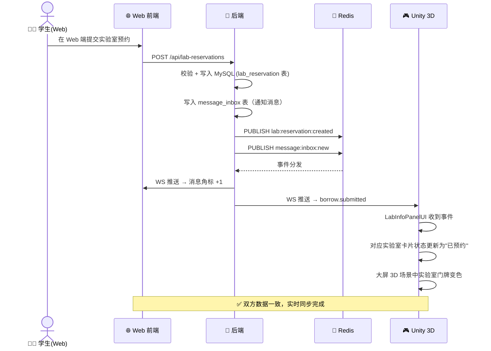

### 8.2 场景二：Unity 大屏提交借用 → Web 端消息中心提醒

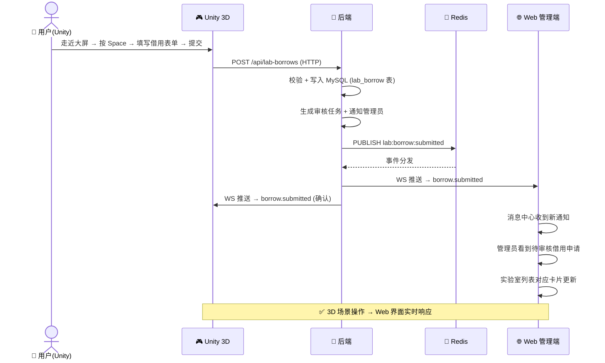

### 8.3 场景三：Web 端添加/更新试剂 → Unity 3D 试剂面板同步

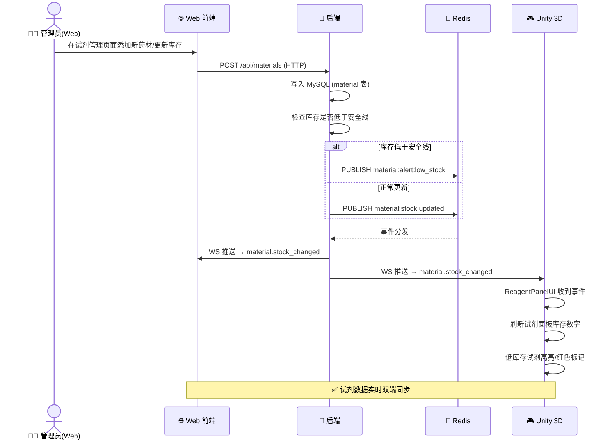

### 8.4 场景四：传感器环境数据实时同步

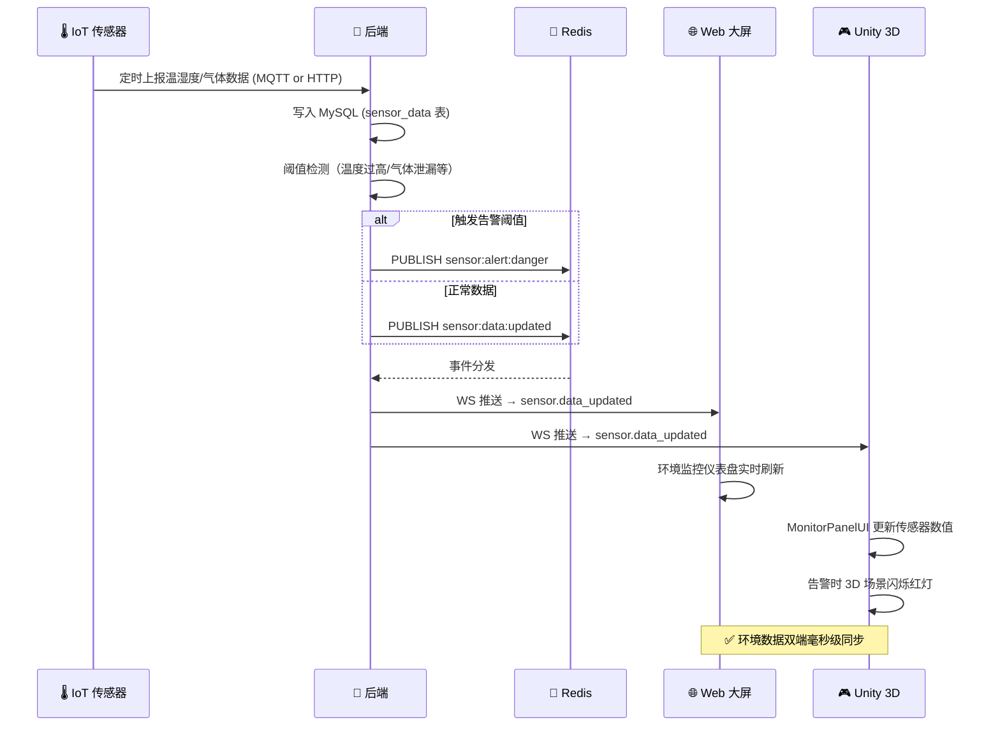

### 8.5 场景五：器材借用全流程（Web 发起 → Unity 实时展示状态）

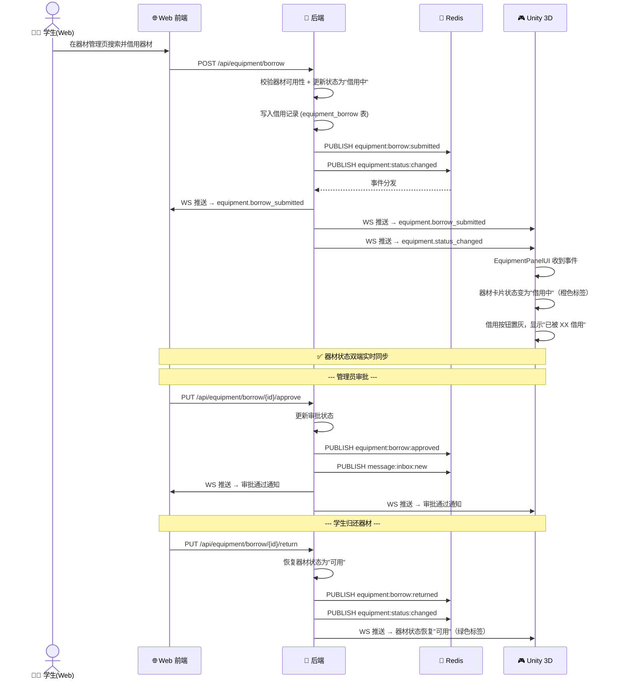

### 8.6 场景六：器材维修上报（Unity 大屏发起 → Web 端处理）

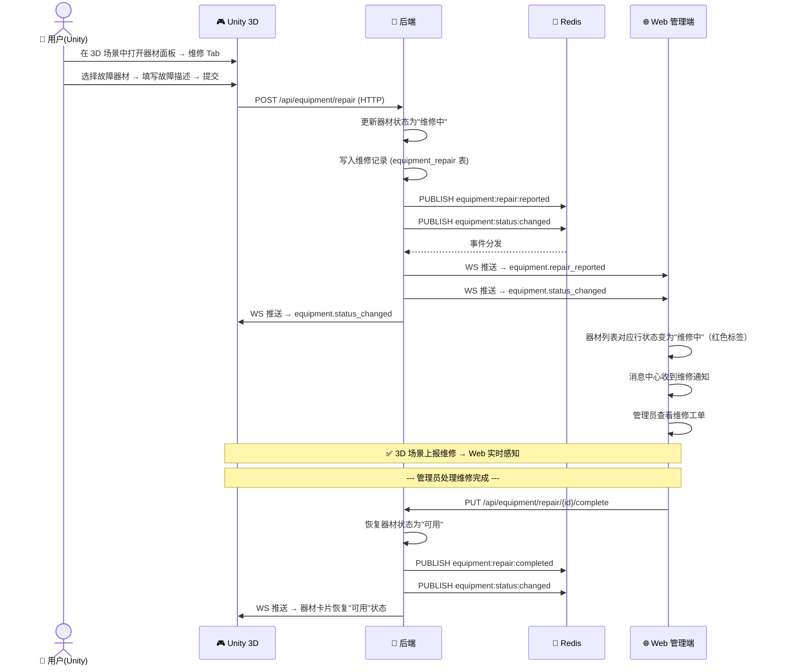

### 8.7 场景七：试剂领用全流程（Web 发起领用 → Unity 面板同步库存）

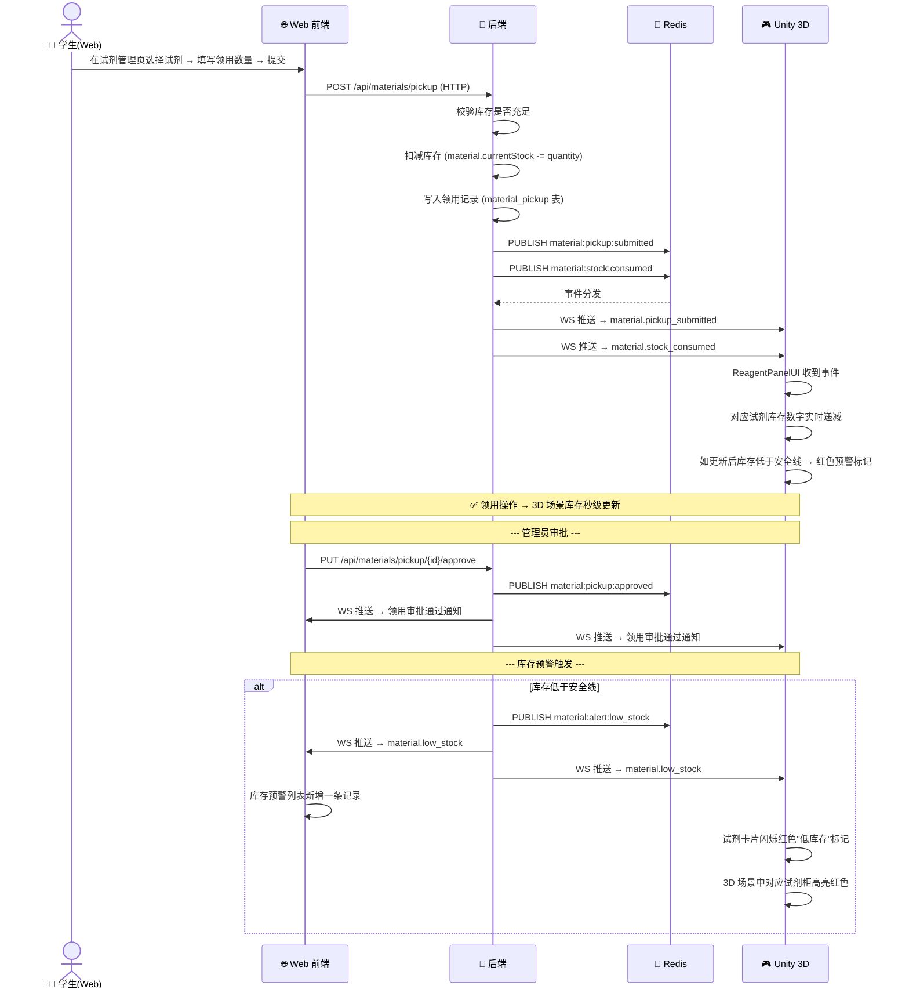

### 8.8 场景八：设备健康监测与故障预警

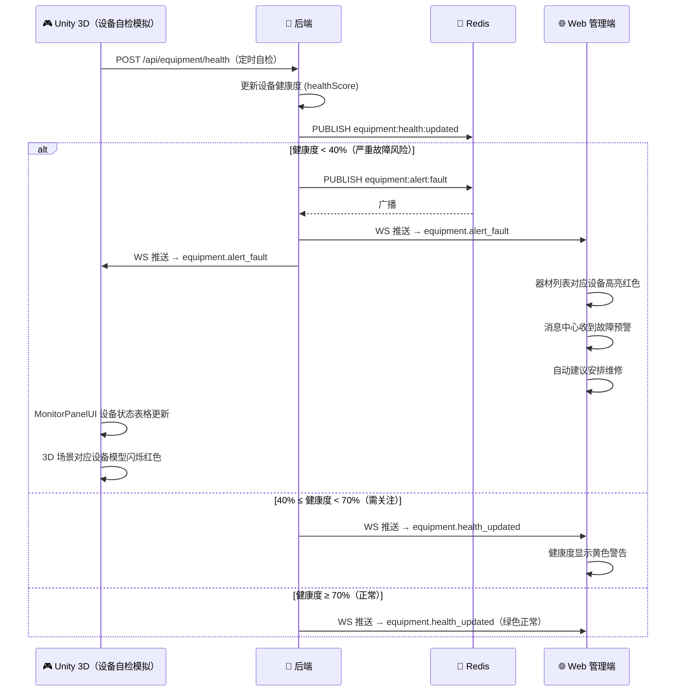

### 8.9 场景九：管理员审核全流程（预约/借用/领用统一审核）

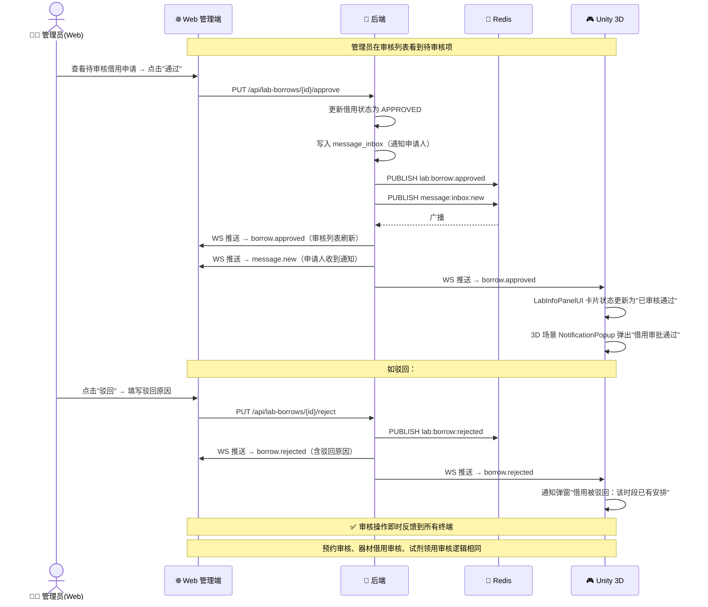

### 8.10 场景十：新药材/试剂入库 → 全端实时同步

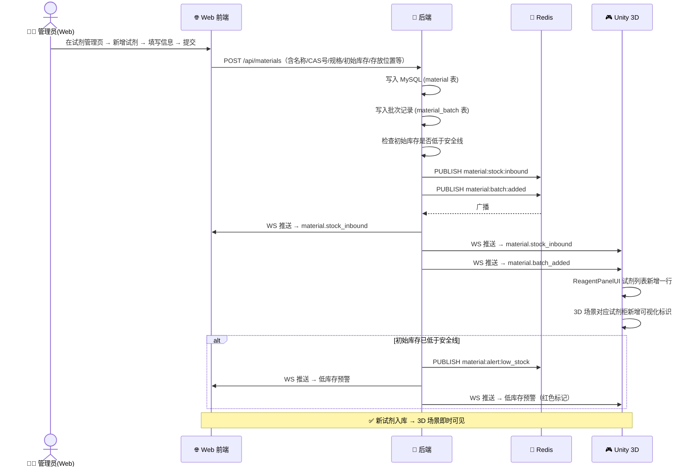

---

## 9. 数据一致性与异常处理

### 9.1 一致性策略

| 策略 | 说明 | 适用场景 |
|------|------|----------|
| **后端权威** | 所有写操作必须经过后端，前端/Unity 不做本地持久化 | 预约、借用、库存变更 |
| **WebSocket 确认** | 操作成功后通过 WS 广播确认，客户端据此刷新本地缓存 | 状态同步 |
| **乐观更新 + 回滚** | 先更新 UI，API 失败后回滚 | 非关键操作（如标记已读） |
| **定期全量同步** | 每 5 分钟或切换场景时，全量拉取最新数据 | Unity 场景加载 / Web 页面刷新 |

### 9.2 WebSocket 连接异常处理

```typescript
// ==================== Web 前端重连策略 ====================

const MAX_RECONNECT_ATTEMPTS = 10
const BASE_RECONNECT_DELAY = 1000  // 1 秒

function scheduleReconnect(attempt: number) {
  if (attempt > MAX_RECONNECT_ATTEMPTS) {
    console.error('[WS] 重连次数已达上限，请刷新页面')
    return
  }

  // 指数退避：1s, 2s, 4s, 8s, 16s, 32s... 最大 60s
  const delay = Math.min(BASE_RECONNECT_DELAY * Math.pow(2, attempt), 60000)

  setTimeout(() => {
    console.log(`[WS] 第 ${attempt + 1} 次重连...`)
    wsClient.connect()
  }, delay)
}
```

```csharp
// ==================== Unity 侧重连策略 ====================

// WebSocketClient.cs 中已实现，关键配置：
public float reconnectInterval = 3f;     // 基础重连间隔
public int maxReconnectAttempts = 10;    // 最大重连次数

// 重连成功后 → 重新拉取完整数据
private async void OnReconnected()
{
    Debug.Log("[WebSocket] 重连成功，刷新全量数据...");
    LabDataProvider.Instance?.RefreshLabsFromServer();
    ReagentDataProvider.Instance?.RefreshReagentsFromServer();
    // ... 其他需要刷新的数据源
}
```

### 9.3 HTTP API 降级

```csharp
// ==================== Unity 侧 API 降级策略 ====================

public void SubmitBorrowRequest(LabBorrowRequest request, Action<bool, string> callback)
{
    // 尝试 HTTP API
    ApiClient.Instance.Post<LabBorrowRequest, BorrowResponse>(
        "/lab-borrows", request,
        (success, response) =>
        {
            if (success)
            {
                callback?.Invoke(true, "预约申请已提交！");
            }
            else
            {
                // 降级方案 1: 本地缓存（离线队列），恢复网络后批量提交
                OfflineQueue.Instance.Enqueue("borrow", JsonUtility.ToJson(request));
                callback?.Invoke(false, "网络异常，申请已暂存，恢复网络后自动提交");

                // 降级方案 2: 使用 Mock 本地校验
                // SimulateLocalSubmit(request, callback);
            }
        }
    );
}
```

---

## 10. 部署与运维

### 10.1 开发环境配置

| 组件 | 地址 | 说明 |
|------|------|------|
| Vue Dev Server | `http://127.0.0.1:5173` | Vite HMR |
| Spring Boot | `http://localhost:8080` | 后端 API + WebSocket |
| Redis | `localhost:6379` | Pub/Sub 消息中间件 |
| MySQL | `localhost:3306` | 数据持久化 |
| Unity Editor | — | 直接连接 `localhost:8080` |

### 10.2 Vue 开发代理配置

```typescript
// vite.config.ts
export default defineConfig({
  server: {
    port: 5173,
    proxy: {
      '/api': {
        target: 'http://localhost:8080',
        changeOrigin: true,
      },
      '/ws': {
        target: 'ws://localhost:8080',
        ws: true,  // 关键：启用 WebSocket 代理
        changeOrigin: true,
      },
    },
  },
})
```

### 10.3 生产环境 Nginx 配置

```nginx
# 关键配置：WebSocket 代理
server {
    listen 443 ssl;
    server_name your-domain.com;

    # API 代理
    location /api/ {
        proxy_pass http://backend:8080/api/;
        proxy_set_header Host $host;
        proxy_set_header X-Real-IP $remote_addr;
    }

    # WebSocket 代理（关键！）
    location /ws/ {
        proxy_pass http://backend:8080/ws/;
        proxy_http_version 1.1;
        proxy_set_header Upgrade $http_upgrade;
        proxy_set_header Connection "upgrade";
        proxy_set_header Host $host;
        proxy_set_header X-Real-IP $remote_addr;
        proxy_read_timeout 86400s;  # 长连接不超时
    }

    # Unity WebGL 静态资源（如适用）
    location /unity/ {
        alias /opt/app/unity-webgl/;
        add_header Content-Encoding gzip;  # Unity WebGL 使用 gzip 压缩
    }

    # Vue SPA
    location / {
        root /opt/app/web-dist;
        try_files $uri $uri/ /index.html;
    }
}
```

### 10.4 后端 WebSocket 并发配置

```yaml
# application.yml
server:
  tomcat:
    max-connections: 10000  # 最大连接数
    threads:
      max: 200              # 工作线程

spring:
  websocket:
    max-text-message-size: 65536   # 最大消息大小 64KB
    max-binary-message-size: 65536
    send-buffer-size-limit: 524288 # 发送缓冲区 512KB
```

### 10.5 监控指标

| 指标 | 含义 | 告警阈值 |
|------|------|----------|
| WebSocket 在线数 | 当前活跃连接数 | < 预期最低值 |
| WebSocket 重连率 | 每分钟重连次数 | > 10 次/分钟 |
| Redis Pub/Sub 延迟 | 发布到消费的时间差 | > 500ms |
| API 响应时间 | HTTP 接口 P99 延迟 | > 3s |
| 事件丢失率 | 发布数 - 消费数 | > 0.1% |

---

## 附录

### A. 依赖清单

| 组件 | 依赖/插件 | 版本 | 用途 |
|------|-----------|------|------|
| Spring Boot | `spring-boot-starter-websocket` | 3.5.x | WebSocket 服务端 |
| Spring Boot | `spring-boot-starter-data-redis` | 3.5.x | Redis Pub/Sub |
| Vue 3 | (原生 WebSocket API) | — | 浏览器原生支持 |
| Unity | [NativeWebSocket](https://github.com/endel/NativeWebSocket) | latest | C# WebSocket 客户端 |
| Unity | `UnityWebRequest` | 内置 | HTTP 客户端 |

### B. 推荐的事件命名规范

```
命名规则: {领域}:{实体}:{动作}

领域 (domain):
  lab          — 实验室管理
  material     — 试剂/药材管理
  equipment    — 器材/设备管理
  sensor       — 传感器/环境监控
  message      — 消息通知
  teaching     — 智能教学

实体 (entity):
  status / info / reservation / borrow
  stock / pickup / batch / alert
  borrow / repair / health / status
  data / device / alert
  inbox
  course / task / score

动作 (action):
  created / updated / changed / submitted / approved / rejected
  returned / cancelled / completed / consumed / added
  inbound / outbound / reported
```

**完整事件清单**：

```
# === 实验室 ===
lab:status:changed              # 状态变更（开放/维护/关闭）
lab:info:updated                # 基础信息修改
lab:reservation:created         # 预约创建
lab:reservation:approved        # 预约审批通过
lab:reservation:rejected        # 预约审批驳回
lab:reservation:cancelled       # 预约取消
lab:borrow:submitted            # 借用提交
lab:borrow:approved             # 借用审批通过
lab:borrow:rejected             # 借用审批驳回
lab:borrow:returned             # 借用归还

# === 试剂/药材 ===
material:stock:inbound          # 新试剂入库
material:stock:updated          # 库存数量变更
material:stock:consumed         # 库存消耗（领用/实验）
material:pickup:submitted       # 领用申请提交
material:pickup:approved        # 领用审批通过
material:pickup:rejected        # 领用审批驳回
material:alert:low_stock        # 低库存预警
material:alert:expiring         # 即将过期预警
material:alert:expired          # 已过期告警
material:batch:added            # 新批次入库

# === 器材/设备 ===
equipment:stock:inbound         # 新器材入库
equipment:borrow:submitted      # 器材借用申请
equipment:borrow:approved       # 器材借用审批通过
equipment:borrow:returned       # 器材归还
equipment:status:changed        # 器材状态变更（可用/借用中/维修中/报废）
equipment:repair:reported       # 维修上报
equipment:repair:completed      # 维修完成
equipment:health:updated        # 健康度更新
equipment:alert:fault           # 设备故障告警

# === 传感器/环境监控 ===
sensor:data:updated             # 传感器数据更新
sensor:alert:temperature        # 温度异常
sensor:alert:humidity           # 湿度异常
sensor:alert:smoke              # 烟雾超标
sensor:alert:gas                # 有害气体超标
sensor:alert:danger             # 综合危险告警
sensor:device:online            # 传感设备上线
sensor:device:offline           # 传感设备离线

# === 消息通知 ===
message:inbox:new               # 新消息到达
message:inbox:read              # 消息已读
message:inbox:batch             # 批量推送

# === 智能教学 ===
teaching:course:updated         # 课程变更
teaching:task:assigned          # 任务分配
teaching:score:entered          # 成绩录入
```

### C. 快速启动检查清单

- [ ] 后端添加 `spring-boot-starter-websocket` 依赖
- [ ] 实现 `WebSocketConfig`、`LabEventHandler`、`WebSocketSessionManager`
- [ ] 配置 Redis Pub/Sub（`RedisSubscriberConfig`、`EventPublisher`、`EventSubscriber`）
- [ ] 在所有业务 Service 的关键操作后调用 `eventPublisher.publish()`：
  - [ ] `LabReservationService` — 预约生命周期
  - [ ] `LabBorrowService` — 借用生命周期
  - [ ] `MaterialService` — 试剂入库/领用/预警
  - [ ] `EquipmentBorrowService` — 器材借用/归还
  - [ ] `EquipmentRepairService` — 器材维修上报/完成
  - [ ] `EquipmentHealthService` — 设备健康监测/故障告警
  - [ ] `SensorDataService` — 传感器数据/阈值告警
  - [ ] `MessageService` — 消息收件箱
- [ ] 前端添加 `wsClient.ts` 并在 `App.vue` 中初始化
- [ ] 前端注册全部 40+ 事件类型的监听处理器
- [ ] 前端配置 `vite.config.ts` WebSocket 代理
- [ ] Unity 导入 `NativeWebSocket` 插件
- [ ] Unity 创建 `ApiClient`、`WebSocketClient` 单例 GameObject
- [ ] Unity 改造各 DataProvider 对接真实 API：
  - [ ] `LabDataProvider` — 实验室数据
  - [ ] `ReagentDataProvider` — 试剂/药材数据
  - [ ] 新增 `EquipmentDataProvider` — 器材/设备数据
  - [ ] 新增 `SensorDataProvider` — 传感器/环境数据
- [ ] Unity 各 Panel UI 注册 WebSocket 事件处理器：
  - [ ] `LabInfoPanelUI` — 监听 lab.* / borrow.* 事件
  - [ ] `ReagentPanelUI` — 监听 material.* 事件
  - [ ] `EquipmentPanelUI` — 监听 equipment.* 事件
  - [ ] `MonitorPanelUI` — 监听 sensor.* / equipment.health.* 事件
  - [ ] `NotificationPopup` — 监听 message.new 事件
- [ ] 端到端测试（10 个业务场景全覆盖）：
  - [ ] 场景一：Web 预约 → Unity 大屏实时展示
  - [ ] 场景二：Unity 借用 → Web 消息中心提醒
  - [ ] 场景三：Web 更新试剂 → Unity 面板同步
  - [ ] 场景四：传感器数据 → 双端实时监控
  - [ ] 场景五：器材借用全流程
  - [ ] 场景六：器材维修上报与处理
  - [ ] 场景七：试剂领用与库存预警
  - [ ] 场景八：设备健康监测与故障预警
  - [ ] 场景九：管理员审核全流程
  - [ ] 场景十：新试剂入库全端同步
- [ ] 配置生产环境 Nginx WebSocket 代理
- [ ] 压力测试：模拟 100+ WebSocket 并发连接

---

> **总结**：通过 **后端作为中枢、HTTP REST 处理 CRUD、WebSocket + Redis Pub/Sub 实现实时推送** 的架构，可以实现 Web 管理平台与 Unity 3D 仿真场景之间的数据互通和毫秒级实时同步。无论用户在哪个端进行操作，所有终端都能即时感知变化，确保实验室管理的一致性和实时性。
