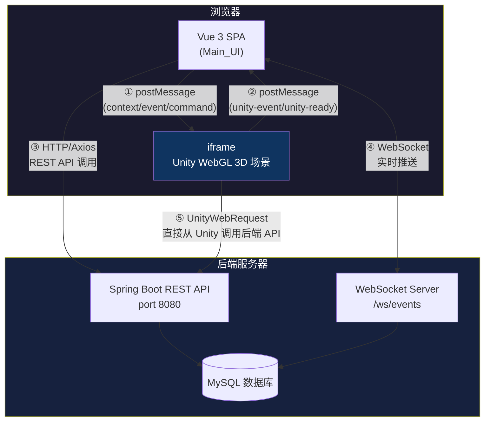
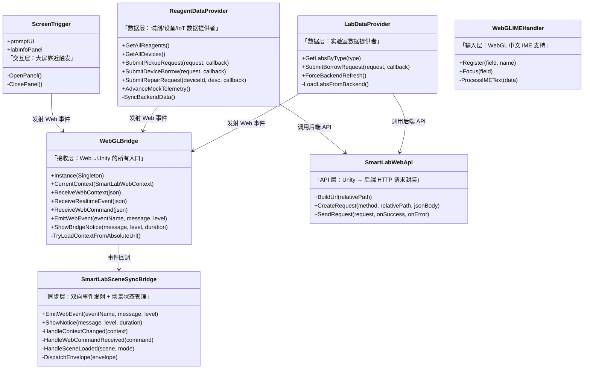
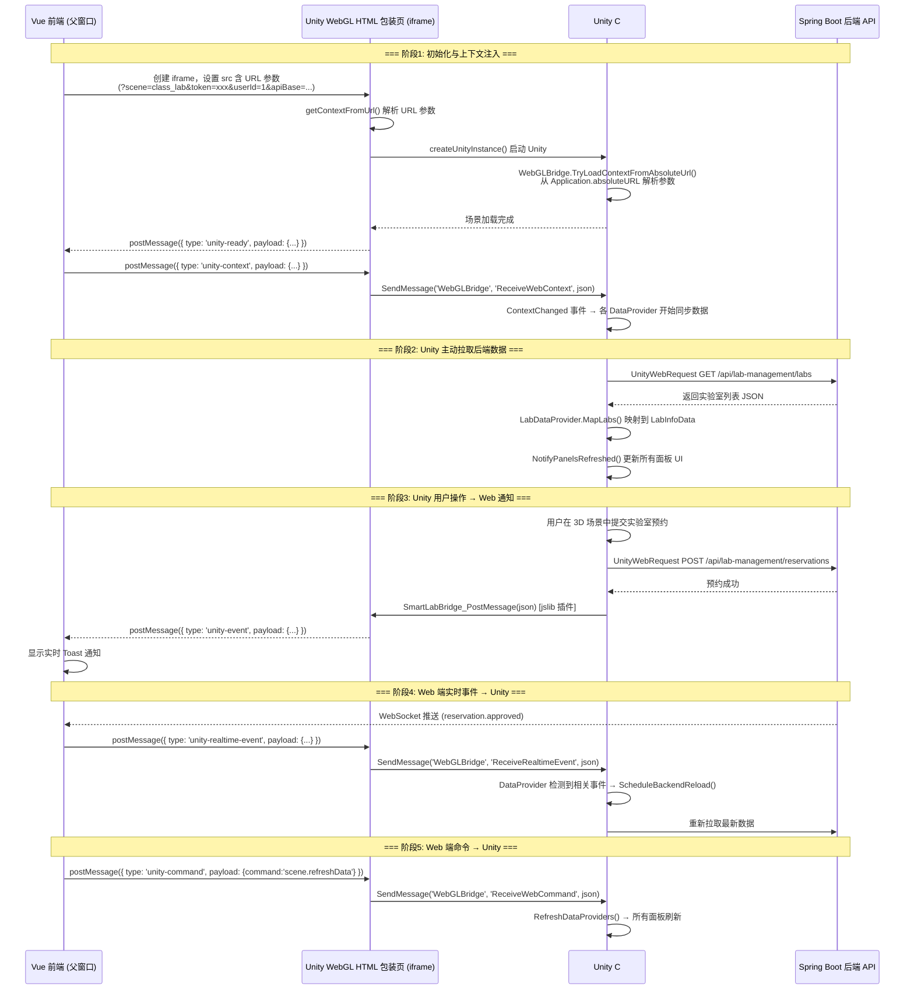
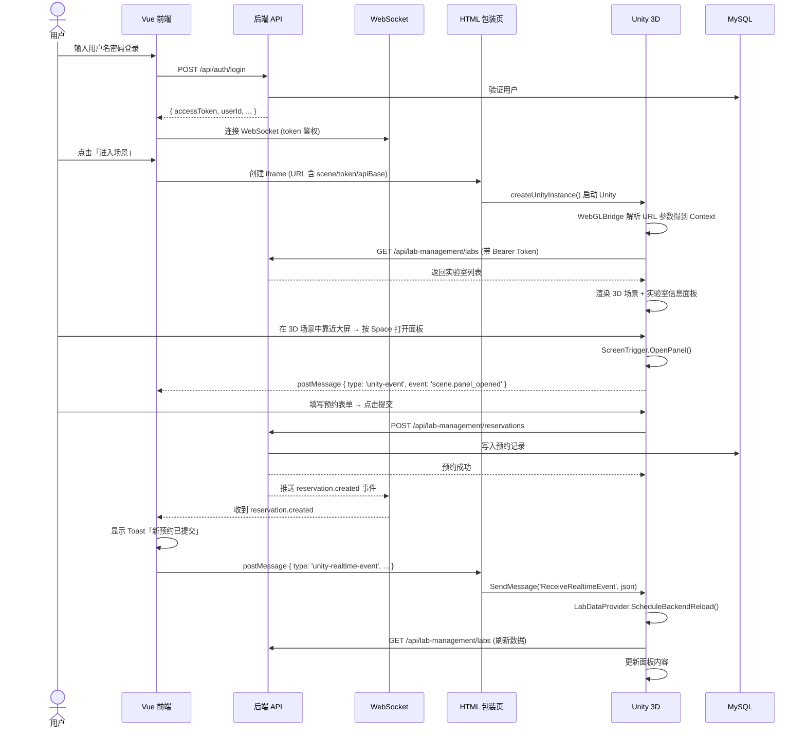

# 智慧实验室系统 — 技术架构与实现详解

> **编写日期**: 2026-07-14  
> **目的**: 帮助开发者快速理解项目整体架构、3D 与 Web 互通机制、前端 API 调用流程及核心实现原理。

---

## 目录

1. [项目总览](#1-项目总览)
2. [整体架构图](#2-整体架构图)
3. [前端架构详解](#3-前端架构详解)
4. [Unity 3D 架构详解](#4-unity-3d-架构详解)
5. [Web ↔ Unity 3D 互通机制（核心）](#5-web--unity-3d-互通机制核心)
6. [后端 API 架构](#6-后端-api-架构)
7. [实时消息推送（WebSocket）](#7-实时消息推送websocket)
8. [数据流全景](#8-数据流全景)
9. [关键文件索引](#9-关键文件索引)

---

## 1. 项目总览

本项目是一个**智慧实验室管理系统**，包含三大子系统：

| 子系统 | 技术栈 | 路径 |
|--------|--------|------|
| **前端主界面** | Vue 3 + TypeScript + Vite + Pinia + Axios | `Intelligent_Experiment_System/Main_File/Main_UI/` |
| **Unity 3D 仿真** | Unity 2022+ (C#), WebGL 构建 | `实验室3D仿真/Lab_Simulation_System/` |
| **后端服务** | Java Spring Boot 3 + MyBatis + MySQL + WebSocket | `Intelligent_Experiment_System/Backend/smart-lab-backend/` |

**核心业务场景**：
- 用户登录后进入主界面，可根据角色（学生/教师/管理员）访问不同功能模块
- **3D 全景展示**模块允许用户在浏览器中漫游 3D 实验室，查看实验室信息、预约实验室、领用试剂器材等
- Unity 3D 场景通过 WebGL 嵌入前端页面，并通过**双向消息桥**与 Web 前端和后端 API 实时互通

---

## 2. 整体架构图



### 通信路径总结

| 路径 | 方向 | 协议 | 用途 |
|------|------|------|------|
| ① | Vue → Unity | `window.postMessage` | 下发登录态、实时事件、场景命令 |
| ② | Unity → Vue | `window.postMessage` | 上报场景事件（面板打开/关闭、预约提交等） |
| ③ | Vue → 后端 | HTTP REST | 登录、CRUD 业务操作 |
| ④ | Vue ↔ 后端 | WebSocket | 实时消息推送 |
| ⑤ | Unity → 后端 | HTTP REST | Unity 内部直接调用后端 API 拉取/提交数据 |

---

## 3. 前端架构详解

### 3.1 技术栈

```
Vue 3 (Composition API) + TypeScript
├── Vite (构建工具)
├── Pinia (状态管理)
├── Axios (HTTP 客户端)
└── 原生 WebSocket (实时推送)
```

### 3.2 目录结构

```
Main_UI/src/
├── App.vue                  # 根组件：页面路由、实时通知 Toast
├── main.ts                  # 入口，创建 Vue 应用
├── style.css                # 全局样式（毛玻璃面板 + 深色主题）
├── components/
│   ├── HeaderBar.vue        # 顶部导航栏
│   ├── Lab3DViewer.vue      # ★ 3D 场景查看器（iframe 管理核心）
│   ├── LoginView.vue        # 登录页面
│   ├── MessageCenter.vue    # 消息中心
│   ├── UserDetail.vue       # 用户详情
│   ├── admin/               # 管理员功能组件（30+ 个）
│   ├── student/             # 学生功能组件
│   └── teacher/             # 教师功能组件
├── stores/
│   ├── authStore.ts         # 认证状态（用户角色、登录态）
│   └── messageStore.ts      # 消息未读数状态
└── utils/
    ├── api.ts               # Axios 实例 + 拦截器
    ├── authApi.ts           # 登录/登出/获取用户信息 API
    ├── labApi.ts            # 实验室管理 API
    ├── wsClient.ts          # ★ WebSocket 客户端
    ├── deviceApi.ts         # 设备相关 API
    ├── materialApi.ts       # 耗材相关 API
    ├── sensorApi.ts         # IoT 传感器 API
    ├── courseApi.ts         # 课程相关 API
    ├── teachingApi.ts       # 教学相关 API
    ├── dashboardApi.ts      # 仪表盘 API
    ├── inboxApi.ts          # 消息收件箱 API
    ├── messageApi.ts        # 消息模板 API
    ├── personnelApi.ts      # 人员管理 API
    └── resourceApi.ts       # 资源管理 API
```

### 3.3 路由机制（无 vue-router）

项目**不使用 vue-router**，而是通过 `App.vue` 中的 `currentPage` 变量和 `v-if/v-else-if` 条件渲染实现页面切换：

```typescript
// App.vue 核心逻辑
const currentPage = ref('home')

function handleNavigate(page: string) {
  currentPage.value = page
}
```

```html
<!-- 按 currentPage 值条件渲染不同组件 -->
<Lab3DViewer v-else-if="currentPage === '3d-show'" />
<LabManage   v-else-if="currentPage === 'lab-manage'" />
```

### 3.4 Axios 封装 (`utils/api.ts`)

```typescript
// 核心要点：
// 1. baseURL = '/api'，通过 Vite 代理转发到后端
// 2. 请求拦截器自动附加 Bearer Token
// 3. 响应拦截器统一处理 code≠0 和 401 未登录

const instance = axios.create({
  baseURL: '/api',
  timeout: 15000,
})

// 请求拦截器：自动带 Token
instance.interceptors.request.use(config => {
  const token = localStorage.getItem('accessToken')
  if (token) config.headers.Authorization = `Bearer ${token}`
  return config
})

// 响应拦截器：统一错误处理
instance.interceptors.response.use(
  response => {
    if (response.data.code !== 0) {
      // code=40100 触发登出
      if (response.data.code === 40100) {
        window.dispatchEvent(new CustomEvent('auth:logout'))
      }
      return Promise.reject(new Error(response.data.message))
    }
    return response
  },
  error => {
    if (error.response?.status === 401) {
      window.dispatchEvent(new CustomEvent('auth:logout'))
    }
    return Promise.reject(error)
  }
)
```

### 3.5 认证流程 (`stores/authStore.ts`)

```
登录流程：
1. 用户输入用户名/密码
2. 调用 POST /api/auth/login
3. 后端返回 { userId, userType, username, accessToken }
4. 前端存入 localStorage: accessToken, userId, userName
5. 连接 WebSocket（使用 token 鉴权）
6. 加载用户完整 profile
7. App.vue 根据 userRole 渲染对应仪表盘

登出流程：
1. 调用 POST /api/auth/logout
2. 清除 localStorage
3. 断开 WebSocket
4. currentPage 回到登录页
```

---

## 4. Unity 3D 架构详解

### 4.1 目录结构

```
实验室3D仿真/Lab_Simulation_System/Assets/
├── Scenes/                          # Unity 场景文件
│   ├── Class_Lab.unity             # 教学实验室
│   ├── Common_Lab.unity            # 通用实验室
│   ├── Computer_Lab.unity          # 计算机实验室
│   ├── Group_Study.unity           # 小组研讨室
│   └── Reagent_Loan.unity          # 试剂器材借用室
├── Scripts/                         # ★ C# 脚本（核心逻辑）
│   ├── SmartLabWebBridge.cs        # ★★ Web ↔ Unity 桥接核心
│   ├── SmartLabSceneSyncBridge.cs  # ★★ 场景双向同步
│   ├── WebGLIMEHandler.cs          # WebGL 中文输入法支持
│   ├── SmartLabDropdownRuntimeFix.cs # TMP_Dropdown WebGL 修复
│   ├── LabData.cs                  # 实验室数据模型 + 数据提供者
│   ├── ReagentData.cs              # 试剂/设备数据模型
│   ├── ReagentDataProvider.cs      # 试剂/设备数据提供者（含后端API调用）
│   ├── LabInfoPanelUI.cs           # 实验室信息面板 UI
│   ├── MonitorPanelUI.cs           # 设备监控面板 UI
│   ├── ReagentPanelUI.cs           # 试剂管理面板 UI
│   ├── EquipmentPanelUI.cs         # 器材管理面板 UI
│   ├── ScreenTrigger.cs            # 大屏交互触发器
│   ├── ExitTrigger.cs              # 出口触发器
│   ├── SceneLoader.cs              # URL 参数场景加载器
│   └── Editor/                     # 编辑器工具脚本
│       ├── LabInfoPanelBuilder.cs  # 大屏 UI 构建器
│       ├── CommonLabPanelBuilder.cs # 通用实验室 UI 构建器
│       ├── ComputerLabPanelBuilder.cs
│       ├── DiscussionLabPanelBuilder.cs
│       ├── ReagentAndEquipmentUIBuilder.cs
│       ├── PromptCanvasBuilder.cs
│       └── AddWallColliders.cs
└── Plugins/
    └── SmartLabBridge.jslib        # ★ WebGL JavaScript 桥接插件
```

### 4.2 Unity WebGL 构建输出

```
3D_Lab_Simulation_Environment/
├── 3D_Lab/               # 教学实验室 WebGL 构建
│   ├── index.html        # ★ WebGL 入口页面（含 JS 桥接代码）
│   ├── Build/            # Unity 构建产物 (.wasm, .js, .data)
│   └── TemplateData/     # Unity 模板样式
└── Common_Lab/           # 通用实验室 WebGL 构建
    ├── index.html
    ├── Build/
    └── TemplateData/
```

### 4.3 核心类关系图



---

## 5. Web ↔ Unity 3D 互通机制（核心）

这是整个项目最核心、最复杂的部分。设计了一个**四层双向桥接架构**。

### 5.1 整体通信模型



### 5.2 第一层：URL 参数注入（初始化上下文）

**文件**: `3D_Lab/index.html` → `getContextFromUrl()`

```javascript
// HTML 包装页在加载时从 URL 参数中提取上下文
function getContextFromUrl() {
  const params = new URLSearchParams(window.location.search);
  return {
    scene: params.get('scene') || '',          // 场景标识，如 "class_lab"
    token: params.get('token') || '',           // JWT Token
    userId: params.get('userId') || '',         // 用户 ID
    userName: params.get('userName') || '',     // 用户名
    apiBase: params.get('apiBase') || `${window.location.origin}/api`,
  };
}
```

**Vue 端如何构建 URL**（`Lab3DViewer.vue`）：

```typescript
const viewerSrc = computed(() => {
  const params = new URLSearchParams({
    scene: viewerSceneKey.value,      // 如 'class_lab'
    token: localStorage.getItem('accessToken') ?? '',
    userId: String(userId.value),
    userName: userName.value,
    apiBase: `${window.location.origin}/api`,
  })
  return `/3D_Lab/index.html?${params.toString()}`
})
```

**Unity 端如何接收**（`SmartLabWebBridge.cs`）：

```csharp
// Unity 启动时从浏览器地址栏读取参数
private void TryLoadContextFromAbsoluteUrl()
{
    string url = Application.absoluteURL;  // WebGL 中即为浏览器完整 URL
    // 解析 ?scene=xxx&token=xxx&...
    context.scene = ExtractQueryValue(url, "scene");
    context.token = ExtractQueryValue(url, "token");
    context.userId = ExtractQueryValue(url, "userId");
    context.userName = ExtractQueryValue(url, "userName");
    context.apiBase = ExtractQueryValue(url, "apiBase");
    ApplyContext(context);
}
```

### 5.3 第二层：Vue ↔ HTML 包装页（postMessage）

**方向 A: Vue → HTML → Unity**

```typescript
// Lab3DViewer.vue 中向 iframe 发送消息
function postToViewer(message: ViewerMessage): void {
  viewerFrame.value?.contentWindow?.postMessage(message, window.location.origin)
}

// 发送上下文同步
postToViewer({
  type: 'unity-context',
  payload: { scene, token, userId, userName, apiBase }
})

// 转发实时事件
postToViewer({
  type: 'unity-realtime-event',
  payload: envelope  // WebSocket 收到的实时事件
})

// 发送命令
postToViewer({
  type: 'unity-command',
  payload: { command: 'scene.refreshData' }
})
```

**HTML 包装页接收并转发到 Unity**：

```javascript
// index.html 中监听来自父窗口的消息
window.addEventListener('message', (event) => {
  if (event.origin !== window.location.origin) return;
  
  if (message.type === 'unity-context') {
    syncContext(message.payload);  // → SendMessage('WebGLBridge', 'ReceiveWebContext', json)
  }
  if (message.type === 'unity-realtime-event') {
    forwardToUnity('ReceiveRealtimeEvent', message.payload);
  }
  if (message.type === 'unity-command') {
    forwardToUnity('ReceiveWebCommand', message.payload);
  }
});

// 核心转发函数
function forwardToUnity(method, payload) {
  if (!window.unityInstance) {
    // Unity 尚未就绪，加入待发送队列
    unityBridgeState.pendingMessages.push({ method, payload });
    return;
  }
  window.unityInstance.SendMessage('WebGLBridge', method, JSON.stringify(payload));
}

// Unity 就绪后刷新待发送队列
function flushPendingMessages() {
  queuedMessages.forEach(({ method, payload }) => forwardToUnity(method, payload));
}
```

**方向 B: Unity → HTML → Vue**

Unity C# 通过 **jslib 插件**调用 JavaScript：

```csharp
// SmartLabSceneSyncBridge.cs
#if UNITY_WEBGL && !UNITY_EDITOR
[DllImport("__Internal")]
private static extern void SmartLabBridge_PostMessage(string json);
#endif

private static void DispatchEnvelope(SmartLabUnityEventEnvelope envelope)
{
    string json = JsonUtility.ToJson(envelope);
#if UNITY_WEBGL && !UNITY_EDITOR
    SmartLabBridge_PostMessage(json);  // 调用 jslib 中定义的 JS 函数
#else
    Debug.Log($"[SmartLabSceneSyncBridge] {json}");
#endif
}
```

对应的 **jslib 插件** (`Plugins/SmartLabBridge.jslib`) 会定义 `SmartLabBridge_PostMessage` 函数，它调用 `window.SmartLabUnityBridge.emitRaw(json)`。

**HTML 包装页中的 JS 桥接对象**：

```javascript
window.SmartLabUnityBridge = {
  emit(eventName, payload) {
    postToParent('unity-event', normalizeUnityEventPayload({ event: eventName, ...payload }));
  },
  emitRaw(rawJson) {
    // 解析 JSON 后 postMessage 到父窗口
    const parsed = JSON.parse(rawJson);
    postToParent('unity-event', normalizeUnityEventPayload(parsed));
  },
};

function postToParent(type, payload) {
  if (window.parent && window.parent !== window) {
    window.parent.postMessage({ type, payload }, window.location.origin);
  }
}
```

**Vue 端接收 Unity 事件**（`Lab3DViewer.vue`）：

```typescript
function handleViewerMessage(event: MessageEvent): void {
  if (event.origin !== window.location.origin) return;
  
  if (message.type === 'unity-ready') {
    viewerReady.value = true;
    syncViewerContext();  // 重新同步上下文
  }
  
  if (message.type === 'unity-event' && message.payload) {
    // Unity 发出的业务事件（预约提交、数据同步等）
    window.dispatchEvent(new CustomEvent('unity-biz-event', { detail: payload }));
    
    // 预约相关事件 → 刷新页面上的预约列表
    if (eventName.includes('reservation') || eventName.includes('borrow')) {
      window.dispatchEvent(new CustomEvent('refresh-reservation-list'));
    }
  }
}
```

### 5.4 第三层：Unity 内部事件分发

**`WebGLBridge`** 是 Unity 侧所有 Web→Unity 消息的接收中枢：

```csharp
public class WebGLBridge : MonoBehaviour
{
    // 三个 Receive 方法由 HTML 包装页通过 SendMessage 调用
    
    public void ReceiveWebContext(string json) {
        // 解析登录上下文 → ContextChanged 事件
    }
    
    public void ReceiveRealtimeEvent(string json) {
        // 解析实时事件 → RealtimeEventReceived 事件
    }
    
    public void ReceiveWebCommand(string json) {
        // 解析 Web 命令 → WebCommandReceived 事件
    }
    
    // 静态事件，供 DataProvider 订阅
    public static event Action<SmartLabWebContext> ContextChanged;
    public static event Action<SmartLabRealtimeMessage> RealtimeEventReceived;
    public static event Action<SmartLabWebCommand> WebCommandReceived;
}
```

**`SmartLabSceneSyncBridge`** 处理所有双向同步逻辑：

```csharp
private void HandleWebCommandReceived(SmartLabWebCommand command)
{
    switch (command.command)
    {
        case "scene.requestState":
            // 向 Web 回传当前场景状态
            EmitWebEvent("scene.state_reported", ...);
            break;
        case "scene.refreshData":
            // 触发所有 DataProvider 重新拉取数据
            RefreshDataProviders();
            break;
        case "scene.showNotice":
            // 在 3D 场景中显示提示
            ShowNotice(notice, level, duration);
            break;
    }
}
```

### 5.5 Unity 直接调用后端 API

Unity **不通过** Vue 前端中转，而是**直接**调用后端 REST API：

```csharp
// SmartLabWebApi 封装了 HTTP 请求逻辑
public static class SmartLabWebApi
{
    // 构建完整的 API URL
    public static string BuildUrl(string relativePath)
    {
        string baseUrl = WebGLBridge.CurrentContext.apiBase;  // 如 "http://localhost:8080/api"
        return $"{baseUrl.TrimEnd('/')}/{relativePath.TrimStart('/')}";
    }

    // 创建带认证的 HTTP 请求
    public static UnityWebRequest CreateRequest(string method, string relativePath, string jsonBody = null)
    {
        UnityWebRequest request = new UnityWebRequest(url, method);
        
        // 设置 JSON 请求体
        if (!string.IsNullOrEmpty(jsonBody)) {
            request.uploadHandler = new UploadHandlerRaw(Encoding.UTF8.GetBytes(jsonBody));
            request.SetRequestHeader("Content-Type", "application/json");
        }
        
        // 设置 Bearer Token 认证
        request.SetRequestHeader("Authorization", $"Bearer {WebGLBridge.CurrentContext.token}");
        
        return request;
    }

    // 发送请求（协程）并回调
    public static IEnumerator SendRequest(UnityWebRequest request, Action<string> onSuccess, Action<string> onError)
    {
        yield return request.SendWebRequest();
        if (request.result != UnityWebRequest.Result.Success) {
            onError?.Invoke(request.error);
        } else {
            onSuccess?.Invoke(request.downloadHandler.text);
        }
    }
}
```

**为什么 Unity 直接调用后端？**
- 减少通信层级，降低延迟
- Vue 前端只管 3D 场景的嵌入和消息转发，不管数据同步
- Unity DataProvider 可以自主决定何时拉取数据（初始化、上下文变更、实时事件、定时刷新等）

### 5.6 数据提供者的「本地+远端」双模式

所有 DataProvider 都支持两种模式：

```csharp
// 以 ReagentDataProvider.SubmitPickupRequest 为例
public void SubmitPickupRequest(ReagentPickupRequest request, Action<bool, string> callback)
{
    if (WebGLBridge.HasUsableContext)  // 有后端连接 → 使用 API
    {
        StartCoroutine(SubmitPickupRequestToBackend(request, callback));
        return;
    }
    
    // 无后端连接 → 使用本地 Mock 数据
    bool success = SubmitPickupRequestLocal(request, out string message);
    callback?.Invoke(success, message);
}
```

**关键判断**：`WebGLBridge.HasUsableContext` — 检查 `apiBase` 和 `token` 是否都已设置。在 Unity Editor 中开发时通常不满足，自动使用 Mock 数据。

---

## 6. 后端 API 架构

### 6.1 技术栈

```
Java 17 + Spring Boot 3.x
├── Spring Security (JWT 认证)
├── Spring WebSocket (实时推送)
├── MyBatis-Plus (ORM)
├── MySQL (数据库)
└── Lombok + MapStruct
```

### 6.2 模块划分

```
com.zhangjintao.project.smart_lab_backend/
├── common/result/            # 统一响应体 ApiResult<T>
├── infrastructure/
│   ├── config/               # WebSocket 配置、安全配置
│   └── realtime/             # 实时推送基础设施
│       ├── model/            # RealtimeEvent, RealtimeEnvelope
│       ├── websocket/        # WebSocket Handler, Session Registry, 握手拦截器
│       ├── RealtimePublisher.java    # 推送接口
│       └── LocalRealtimePublisher.java # 本地实现
└── modules/
    ├── auth_profile/         # 认证与用户资料
    │   ├── controller/       # AuthController, ProfileController
    │   ├── service/          # AuthService, ProfileService
    │   └── model/dto/        # AuthenticatedUser
    ├── lab_management/       # 实验室管理
    │   ├── controller/       # LabController, ReservationController
    │   └── service/          # LabService
    ├── intelligent_teaching/ # 智能教学
    ├── message_inbox/        # 消息中心
    ├── personnel_management/ # 人员管理
    └── ...
```

### 6.3 统一响应格式

```json
{
  "code": 0,
  "message": "操作成功",
  "data": { ... },
  "metadata": { ... }
}
```

### 6.4 关键 API 接口（Unity 调用的）

| 接口 | 方法 | 用途 |
|------|------|------|
| `/api/lab-management/labs` | GET | 获取实验室列表（分页） |
| `/api/lab-management/labs/{id}` | GET | 获取实验室详情（含开放时间） |
| `/api/lab-management/reservations` | POST | 提交实验室预约 |
| `/api/material/materials` | GET | 获取物资/试剂列表 |
| `/api/material/materials/{id}` | GET | 获取物资详情（含批次） |
| `/api/material/receives` | GET | 获取领用记录 |
| `/api/equipment/devices` | GET | 获取设备列表 |
| `/api/equipment/borrows` | GET | 获取设备借用记录 |
| `/api/equipment/repairs` | GET | 获取维修记录 |

---

## 7. 实时消息推送（WebSocket）

### 7.1 后端 WebSocket 架构

```
客户端 WebSocket 请求: ws://host/ws/events?token=xxx
         ↓
AuthTokenHandshakeInterceptor (握手拦截器)
   ├── 从 URL 参数提取 token
   ├── 查数据库验证 token 有效性
   ├── 查询用户账户和资料
   └── 构建 AuthenticatedUser 存入 session attributes
         ↓
RealtimeWebSocketHandler
   ├── afterConnectionEstablished: 注册 session 到 RealtimeSessionRegistry
   ├── handleTextMessage: 处理心跳 PING → PONG
   └── afterConnectionClosed: 从 registry 移除 session
         ↓
RealtimeSessionRegistry (会话管理)
   ├── broadcast(payload): 广播给所有在线用户
   ├── sendToUsers(userIds, payload): 推送给指定用户
   └── onlineCount(): 获取在线人数
```

### 7.2 前端 WebSocket 客户端 (`utils/wsClient.ts`)

```typescript
// 核心特性：
// 1. 自动重连（3秒间隔）
// 2. 心跳保活（25秒间隔发送 PING）
// 3. 消息分发到全局自定义事件

export function connectRealtime(): void {
  const token = localStorage.getItem('accessToken')
  if (!token) return
  
  const url = `ws://${window.location.host}/ws/events?token=${encodeURIComponent(token)}`
  socket = new WebSocket(url)
  
  socket.onmessage = (event) => {
    const parsed = JSON.parse(event.data) as RealtimeEnvelope
    // 通过 CustomEvent 分发给所有监听者
    window.dispatchEvent(new CustomEvent(REALTIME_EVENT_NAME, { detail: parsed }))
    window.dispatchEvent(new CustomEvent(`realtime:${parsed.event}`, { detail: parsed }))
  }
  
  socket.onclose = () => {
    // 3 秒后自动重连
    setTimeout(connectRealtime, 3000)
  }
}
```

### 7.3 实时事件流（Web → Unity 转发）

```typescript
// App.vue 中监听所有 WebSocket 实时事件
window.addEventListener(REALTIME_EVENT_NAME, handleRealtimeEvent)

// Lab3DViewer.vue 中额外监听，转发给 Unity iframe
function handleRealtimeEvent(event: Event): void {
  const envelope = (event as CustomEvent<RealtimeEnvelope>).detail
  postToViewer({
    type: 'unity-realtime-event',
    payload: envelope,
  })
}
```

### 7.4 实时通知 Toast（`App.vue`）

前端右上角显示实时通知气泡（最多 4 条，8 秒自动消失）：

```typescript
// 事件名 → 中文标题映射
function realtimeTitle(eventName: string): string {
  const titleMap = {
    'message.new': '收到新消息',
    'lab.status_changed': '实验室状态更新',
    'reservation.approved': '预约已通过',
    'equipment.borrow_submitted': '设备借用申请提交',
    'material.stock_changed': '物资库存变化',
    // ... 40+ 种事件类型
  }
  return titleMap[eventName] || '业务数据已更新'
}
```

---

## 8. 数据流全景

### 8.1 用户登录 → 进入 3D 场景 → 预约实验室 全流程



---

## 9. 关键文件索引

### 9.1 Web ↔ Unity 互通（最核心）

| 文件 | 作用 |
|------|------|
| `实验室3D仿真/.../Scripts/SmartLabWebBridge.cs` | Unity 侧桥接核心：接收 Web 消息，管理 Context，提供 API 调用封装 |
| `实验室3D仿真/.../Scripts/SmartLabSceneSyncBridge.cs` | 场景双向同步：发射事件、处理 Web 命令、显示通知 |
| `3D_Lab/index.html` (和 Common_Lab) | HTML 包装页：URL 参数解析、postMessage 收发、Unity 实例管理 |
| `Main_UI/src/components/Lab3DViewer.vue` | Vue 侧 3D 查看器：iframe 管理、消息转发、上下文同步 |
| `Plugins/SmartLabBridge.jslib` | Unity → JS 桥接插件（`DllImport("__Internal")` 对应的 JS 实现） |

### 9.2 数据层

| 文件 | 作用 |
|------|------|
| `实验室3D仿真/.../Scripts/LabData.cs` | 实验室数据模型 + LabDataProvider（含 Mock 数据生成 + 后端 API 调用） |
| `实验室3D仿真/.../Scripts/ReagentData.cs` | 试剂/设备/IoT 数据模型 |
| `实验室3D仿真/.../Scripts/ReagentDataProvider.cs` | 试剂器材室数据提供者（含完整后端 API 同步流程） |

### 9.3 前端核心

| 文件 | 作用 |
|------|------|
| `Main_UI/src/App.vue` | 根组件：页面路由、实时通知 Toast、WebSocket 事件处理 |
| `Main_UI/src/utils/api.ts` | Axios 封装：拦截器、Token 注入、401 处理 |
| `Main_UI/src/utils/wsClient.ts` | WebSocket 客户端：连接、心跳、重连、事件分发 |
| `Main_UI/src/stores/authStore.ts` | 认证状态管理：登录/登出/角色 |

### 9.4 后端核心

| 文件 | 作用 |
|------|------|
| `Backend/.../controller/LabController.java` | 实验室 CRUD REST API |
| `Backend/.../controller/ReservationController.java` | 实验室预约 API |
| `Backend/.../websocket/RealtimeWebSocketHandler.java` | WebSocket 连接处理 |
| `Backend/.../websocket/AuthTokenHandshakeInterceptor.java` | WebSocket 握手鉴权 |
| `Backend/.../websocket/RealtimeSessionRegistry.java` | WebSocket 会话管理（广播/定向推送） |

### 9.5 UI 面板（Unity Editor 构建）

| 文件 | 作用 |
|------|------|
| `Scripts/Editor/LabInfoPanelBuilder.cs` | 大屏交互 UI 构建器（Editor 工具） |
| `Scripts/Editor/CommonLabPanelBuilder.cs` | 通用实验室 UI 构建器 |
| `Scripts/Editor/ReagentAndEquipmentUIBuilder.cs` | 试剂器材室 UI 构建器 |

---

## 附录：关键技术决策与设计思路

### A. 为什么使用 iframe 嵌入 Unity WebGL？

- **隔离性**：Unity WebGL 构建有自己独立的 DOM 和 JS 运行时，iframe 提供了天然的沙箱隔离
- **灵活性**：可以随时加载/卸载 3D 场景而不影响主应用
- **通信标准化**：postMessage 是浏览器原生 API，跨域安全可控

### B. 为什么 Unity 不通过 Vue 中转 API 调用？

- **减少延迟**：减少一次网络往返
- **解耦**：Unity 可以自主决定何时拉取数据，不依赖前端页面状态
- **离线可用**：即使前端页面刷新，Unity iframe 仍可独立运行
- **Mock 回退**：当 `apiBase` 不可用时，自动使用本地 Mock 数据，保证编辑器开发体验

### C. 消息队列（待发送队列）的设计

HTML 包装页中的 `pendingMessages` 队列解决了 Unity 尚未初始化完成时的消息丢失问题：

```javascript
function forwardToUnity(method, payload) {
  if (!window.unityInstance) {
    unityBridgeState.pendingMessages.push({ method, payload });  // 暂存
    return;
  }
  window.unityInstance.SendMessage('WebGLBridge', method, JSON.stringify(payload));
}

// Unity 就绪后批量发送
function flushPendingMessages() {
  queuedMessages.forEach(({ method, payload }) => forwardToUnity(method, payload));
  unityBridgeState.pendingMessages.length = 0;
}
```

### D. WebGL 中文输入问题的解决

Unity WebGL 默认不支持中文输入法（IME），项目通过 `WebGLIMEHandler.cs` + jslib 插件解决：
- 创建一个隐藏的 HTML `<input>` overlay 在 Unity Canvas 上方
- 当用户点击 TMP_InputField 时，激活 HTML input 获取焦点
- 用户输入完成后，将文本传回 Unity 的 TMP_InputField

### E. TMP_Dropdown 在 WebGL 中的修复

Unity 的 TMP_Dropdown 在 WebGL 中经常出现列表不显示、点击不响应等问题。项目通过 `SmartLabDropdownRuntimeFix.cs` 完全接管了 Dropdown 的展开和选择逻辑，使用自定义的 fallback 实现替代原生列表。
